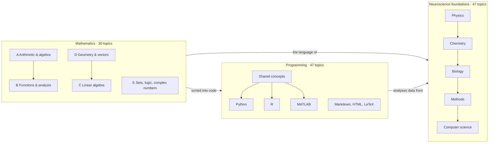

# 🧠 BasicScienceVault – Master Roadmap

> **Start here.** This note ties the whole vault together: what is in it, in which order to work through it, and how to work with it.
> Field roadmaps: [[00 Roadmap|Math]] · [[MOC-neuroscience-foundations|Neuroscience foundations]] · [[MOC-programming|Programming]]

## What this vault is
**BasicScienceVault** reviews the foundations you need to understand – and do – neuroscience: the **mathematics**, the **natural sciences** (physics, chemistry, biology), the **methods**, the **computer-science concepts** for data and models, and the **programming** skills to apply them. It starts at school level and goes up to the level of neuroscience papers and analysis pipelines.

Every topic follows the same pattern:

| Part | What it contains |
|---|---|
| 📘 **Topic note** | rules and concepts explained with examples, a `#neuro` section (applications in neuroscience), `#math-link`s and *Connections* |
| ✏️ **Worksheet** | tasks from easy to hard; done on paper (no calculator except 🧮, no computer except 💻) |
| ✅ **Solutions** | worked solutions with the reasoning, not just results |
| ⚠️ **Mistake log** (one per field) | pre-filled classic traps + your own mistakes – the most valuable part once you use it |
| 🗺️ **MOC** (map of content, one per field) | table of topics, recommended order, connection diagram, progress checklist |

## The three areas at a glance



| Area | Field | Map of content | Mistake log | Topics |
|---|---|---|---|---|
| **Mathematics** | A · Arithmetic & algebra | [[A0 Basics MOC]] | [[Mistakes - Basics]] | A1–A8 |
| | B · Functions & analysis | [[B0 Analysis MOC]] | [[Mistakes - Analysis]] | B1–B12 |
| | C · Linear algebra | [[C0 Linear Algebra MOC]] | [[Mistakes - Linear Algebra]] | C1–C4 |
| | D · Geometry & vectors | [[D0 Geometry and Vectors MOC]] | [[Mistakes - Geometry and Vectors]] | D1–D4 |
| | E · Language & cross-cutting | [[E0 Foundations MOC]] | [[Mistakes - Foundations]] | E1–E2 |
| **Neuroscience foundations** | Physics | [[MOC-physics]] | [[Mistakes - Physics]] | Ph01–Ph12 |
| | Chemistry | [[MOC-chemistry]] | [[Mistakes - Chemistry]] | Ch01–Ch08 |
| | Biology | [[MOC-biology]] | [[Mistakes - Biology]] | Bio01–Bio07 |
| | Methods | [[MOC-methods]] | [[Mistakes - Methods]] | Meth01–Meth06 |
| | Computer science (concepts) | [[MOC-computer-science]] | [[Mistakes - Computer Science]] | CS01–CS14 |
| **Programming** | Shared concepts | [[Prog00 Shared Programming Concepts]] | [[Mistakes - Programming Basics]] | Prog00 |
| | Python | [[Py00 Python Overview]] | [[Mistakes - Python]] | Py01–Py13 |
| | R | [[R00 R Overview]] | [[Mistakes - R]] | R01–R11 |
| | MATLAB | [[MAT00 MATLAB Overview]] | [[Mistakes - MATLAB]] | MAT01–MAT12 |
| | Markdown, HTML & LaTeX | [[Doc00 Markdown HTML and LaTeX Overview]] | [[Mistakes - Markdown HTML LaTeX]] | Doc01–Doc10 |

In total: **124 topics**, each with theory note, worksheet and solutions, plus 15 mistake logs and the maps of content.

### Folder structure
```text
BasicScienceVault/
├── 000 BasicScienceVault.md        ← this note
├── 00 Roadmap.md                   ← math roadmap (13 stages)
├── 01_Basics/ … 05_Foundations/    ← math A–E (topic notes, Worksheets/, Solutions/)
├── _Templates/                     ← note templates (mistake entry, lecture note, new topic)
└── neuro-foundations/
    ├── MOC-neuroscience-foundations.md   ← neuroscience roadmap (19 stages)
    ├── 01-chemistry/ 02-biology/ 03-methods/ 04-physics/ 05-computer-science/
    └── 06-programming/                   ← programming roadmap (P1–P8) in MOC-programming
```
Links use note names, not paths – you can move folders in Obsidian without breaking anything.

## Naming scheme
| Prefix | Field | Example |
|---|---|---|
| `A`–`E` + number | math fields | `B10 Differential Equations` |
| `Ph`, `Ch`, `Bio`, `Meth`, `CS` | physics, chemistry, biology, methods, computer science | `Ph05 Capacitance and RC Circuits` |
| `Prog`, `Py`, `R`, `MAT`, `Doc` | programming: shared, Python, R, MATLAB, Markdown/HTML/LaTeX | `Py05 NumPy and Arrays` |
| `… - Worksheet`, `… - Solutions` | practice notes of a topic | `Py05 NumPy and Arrays - Worksheet` |
| `X0 … MOC`, `MOC-…`, `…00 … Overview` | maps of content | `MOC-physics`, `R00 R Overview` |
| `Mistakes - …` | mistake logs | `Mistakes - MATLAB` |

## The master learning path
The three areas run **in parallel** – each one makes the others easier. Math gives the language, the neuroscience notes give the meaning, programming lets you calculate, simulate and plot what you learn. The phases below combine the stages of the three field roadmaps; the stage numbers refer to [[00 Roadmap]] (Math 1–13), [[MOC-neuroscience-foundations]] (Neuro 1–19) and [[MOC-programming]] (P1–P8).

| Phase | Mathematics | Neuroscience foundations | Programming | Goal of the phase |
|---|---|---|---|---|
| **1 · School foundations** | stages 1–3: [[A1 Exponent Rules]] … [[A8 Solving Equations]], [[A3 Logarithms]], [[B2 Exponential Functions]], [[B3 Logarithmic Functions]] | stages 1–2: [[Ph01 Mechanics and Energy]], [[Ph02 Electricity and Charge]], [[Ch01 Atomic Structure]] … [[Ch03 Intermolecular Forces and Solubility]] | P1 + start P2/P3: [[Prog00 Shared Programming Concepts]], [[Py01 Python Basics and Syntax]] … [[Py03 Python Control Flow and Functions]]; [[Doc01 Markdown Syntax]], [[Doc02 Math in Markdown]] | calculate safely with powers, logs, units; charge, current, voltage; first scripts; write notes with formulas |
| **2 · The electrical membrane** | stages 4–6: [[D4 Unit Circle Trigonometry]], [[B4 Trigonometric Functions]], [[B1 Properties of Functions]], [[B5 Limits and Continuity]] | stages 3–6: [[Ph03 Electric Fields and Potential]] … [[Ph05 Capacitance and RC Circuits]], [[Ph07 Diffusion and Transport]], [[Ph08 Thermodynamics and Statistics]], [[Ch04 Acids Bases and pH]] … [[Ch08 Biomolecules]] | P2/P3: [[Py04 Python Files and Data Formats]], ⭐ [[Py05 NumPy and Arrays]]; [[Doc03 HTML Basics]], [[Doc04 HTML for Reports and Figures]] | Nernst and RC circuits understood; plot exponentials and the membrane charging curve in NumPy |
| **3 · Calculus and the neuron** | stages 7–9: [[B6 Differentiation Rules]], [[B7 Antiderivatives and Integration]], [[B8 Curve Sketching]], [[B9 Taylor Series]] + **[[B10 Differential Equations]]** (from stage 13, needed now) | stages 7–10: [[Bio01 Cell Biology]] … [[Bio07 Neural Circuits and Systems]], [[Ph10 Signal Propagation and Cable Theory]] | P4: [[R01 R Basics and Syntax]] … [[R06 ggplot2 Visualization]]; LaTeX: [[Doc05 LaTeX Basics]], [[Doc06 LaTeX Math]] | action potentials and synapses as equations; simulate a LIF neuron (Euler loop); tidy data and ggplot2 |
| **4 · Vectors, matrices and measuring the brain** | stages 10–12: [[D1 Vectors in 2D and 3D]] … [[D3 Lines and Planes]], [[C1 Matrices]] … [[C4 Eigenvalues and Eigenvectors]], [[E2 Complex Numbers]] + **[[B12 Fourier Analysis]]** | stages 11–14: [[Ph09 Waves and Oscillations]], [[Ph06 Magnetism and Induction]], [[Ph11 Optics and Fluorescence]], [[Ph12 Quantum Basics for Biophysics]], [[Meth01 Microscopy]] … [[Meth06 Omics and Sequencing]] | P5: [[MAT01 MATLAB Basics and Syntax]] … [[MAT03 MATLAB Control Flow and Functions]]; [[Doc07 LaTeX Documents and TeX Live]], [[Doc09 LaTeX with VS Code]] | EEG, MEG, fMRI, imaging: what is measured; linear algebra and spectra in code |
| **5 · Data, statistics and models** | stage 13: [[B11 Multivariable Calculus]] (and review B10, B12) | stages 15–17: [[CS01 Mathematical Foundations]] … [[CS09 Probabilistic and Bayesian Models]] | P6: [[Py06 pandas and Tabular Data]] … [[Py10 Python Neuroscience Packages]], ⭐ [[R07 R Statistical Modelling]], ⭐ [[R08 R Mixed-Effects Models]], [[MAT04 MATLAB Data Import and Files]] … [[MAT07 MATLAB Statistics Toolbox]], [[MAT09 EEGLAB]]; [[Doc08 LaTeX Figures Tables and References]] | statistics, ML and validation as concepts *and* in code; first analysis of a real data set |
| **6 · Brain models, analysis and your own project** | review via the mistake logs | stages 18–19: [[CS10 Dynamical and Computational Neuro Models]] … [[CS14 Hardware Essentials]] | P7–P8: [[Py11 PsychoPy Experiment Control]], [[MAT08 Psychtoolbox]], [[Py12 Python Object-Oriented Programming]], [[Py13 Python Reproducible Projects and Testing]], [[R09 R Neuroscience Packages]] … [[R11 R Reproducible Projects]], [[MAT10 MATLAB Neuroscience Toolboxes]] … [[MAT12 MATLAB Reproducible Projects]], [[Doc10 When to Use What]] | a complete, reproducible mini project (capstone, see below) |

**How long?** At roughly 6–8 hours per week, plan about 4–6 weeks per phase, i.e. 6–9 months in total. Topics you already know well: read the key takeaways, do levels 3–4 of the worksheet, and move on if you get everything right.

**Shortcuts by goal**
| Goal | Focus |
|---|---|
| understand papers and lectures | phases 1–4 fully, CS02/CS06/CS12 from phase 5 |
| analyse EEG/MEG data | B12, C1–C4, Ph09, Meth03, CS11, Py05, Py08, Py10 (MNE), MAT09 (EEGLAB), R08 |
| analyse fMRI data | C1–C4, Meth04, CS12, Py10 (Nilearn, fMRIPrep), MAT10 (SPM), R07–R08 |
| computational modelling | B10–B12, C4, Ph05, Ph10, Bio05–Bio06, CS10, Py08, Py10 (Brian2), Py12 |
| behavioural experiments | A–B basics, CS02, CS06, Py11 or MAT08, R05–R08 |

### Key cross-cutting threads
These threads run through all three areas – following one is a great way to review:
| Thread | Path |
|---|---|
| **From ion to action potential to simulation** | [[A3 Logarithms]] → [[Ch05 Redox and Electrochemistry]] → [[Ph05 Capacitance and RC Circuits]] → [[B10 Differential Equations]] → [[Bio05 Neurons and Action Potentials]] → [[CS10 Dynamical and Computational Neuro Models]] → [[Py08 SciPy Scientific Computing]] |
| **From rhythm to spectrum** | [[B4 Trigonometric Functions]] → [[E2 Complex Numbers]] → [[B12 Fourier Analysis]] → [[Ph09 Waves and Oscillations]] → [[Meth03 Electrophysiology]] → [[CS11 Time Series and Signal Processing]] → [[MAT06 MATLAB Signal Processing Toolbox]] |
| **From matrix to brain map** | [[C1 Matrices]] → [[C3 Linear Systems and Gaussian Elimination]] → [[C4 Eigenvalues and Eigenvectors]] → [[CS01 Mathematical Foundations]] → [[Meth04 In Vivo Imaging]] → [[CS12 Neuroimaging Data Analysis]] → [[Py10 Python Neuroscience Packages]] |
| **From trial to statistics** | [[Py11 PsychoPy Experiment Control]] → [[CS02 Probability and Statistics]] → [[CS06 Data Science Workflow]] → [[R05 dplyr and tidyr]] → [[R08 R Mixed-Effects Models]] → [[R10 R Markdown and Quarto]] |
| **Learning in brains and machines** | [[B6 Differentiation Rules]] → [[B11 Multivariable Calculus]] → [[CS04 Optimization]] → [[CS08 Deep Neural Networks]] → [[Bio06 Synapses and Neurotransmitters]] → [[Py09 Python Machine Learning Libraries]] |
More threads: [[MOC-neuroscience-foundations]] (section *Key cross-cutting threads*), [[MOC-programming]] (*Connections to the other sections*), [[00 Roadmap]] (*The big connections*).

## Capstone project (end of phase 6)
Bring everything together in one small, reproducible project:
1. **Pick an open data set**, e.g. an EEG oddball or resting-state data set from OpenNeuro, or a Neuropixels session from DANDI.
2. **Set up a project** with environment file, folder structure and git ([[Py13 Python Reproducible Projects and Testing]], [[CS13 Reproducibility and Research Software]]).
3. **Preprocess** with MNE or EEGLAB ([[Py10 Python Neuroscience Packages]], [[MAT09 EEGLAB]]), explaining each step with the physics and methods notes.
4. **Analyse**: spectra or ERPs ([[CS11 Time Series and Signal Processing]]), statistics with mixed models ([[R08 R Mixed-Effects Models]]), optionally decoding ([[Py09 Python Machine Learning Libraries]]).
5. **Model**: fit or simulate a simple model of the effect ([[CS10 Dynamical and Computational Neuro Models]]).
6. **Report** in Quarto (HTML) and a short LaTeX write-up with figures and references ([[R10 R Markdown and Quarto]], [[Doc08 LaTeX Figures Tables and References]]).

## How to work with this vault
**For each topic**
1. **Read** the topic note. Cover the worked examples and try them first; say the key takeaways aloud in your own words.
2. **Do the worksheet** on paper: levels 1–2 (recall, understanding), level 3 (calculation/code), level 4 (transfer to neuroscience). 🧮 = calculator allowed, 💻 = run it on a computer.
3. **Check** with the solutions – compare the steps, not only the result.
4. **Log every mistake** in the field's mistake log ([[Mistake Entry Template]]): what you did, what is right, and a quick check that would have caught it.
5. **Tick off** the topic in the field's MOC and the phase below.

**Weekly rhythm (suggestion)**
| Day | Activity |
|---|---|
| 2–3 sessions | new topics (theory + worksheet), alternating between the three areas |
| 1 session | programming practice: re-do a 💻 task, or implement something from a math/neuro note (plot it, simulate it) |
| 15 min daily | flashcards (Anki, see below) |
| end of week | re-read your last mistake-log entries, re-do those tasks without looking |

**Flashcards with Anki** (setup in the *BasicScienceVault Setup Guide*): turn key takeaways, formulas and – above all – your own mistake-log entries into cards with the *Obsidian to Anki* plugin. Good cards ask one thing: "Membrane time constant τ = ?", "Python: `x[2:5]` has how many elements?", "Why `filtfilt` and not `filter` for ERP latencies?".

**Lecture notes**: use [[Lecture Note Template]] (tag `#lecture`) and link them to topic notes – they then appear in the topic's backlinks.

> [!tip] Obsidian views
> - **Graph view** (colour groups by path or tag, e.g. `path:neuro-foundations/06-programming`) shows how topics connect.
> - **Backlinks** on any topic note show every note that builds on it – including your lecture notes and mistakes.
> - **Search** `tag:#neuro` or `tag:#type/worksheet` for cross-sections; `line:(🧮)` finds calculator tasks.
> - The section **"Where this is used in the vault"** at the end of every math note lists all notes that use it.

## Tags
| Tag | Meaning |
|---|---|
| `#type/overview` `#type/worksheet` `#type/solution` `#type/mistakes` `#type/moc` `#type/template` | kind of note |
| `#basics` `#analysis` `#linear-algebra` `#geometry` `#foundations` | math fields |
| `#physics` `#chemistry` `#biology` `#methods` `#computer-science` | neuroscience fields |
| `#programming` `#python` `#r` `#matlab` `#markdown` `#html` `#latex` | programming |
| `#neuro`, `#math-link` | neuroscience application sections, links to math |
| `#lecture` | your own lecture notes |
| `#mistake/…` | your own mistake entries (e.g. `#mistake/sign`, `#mistake/concept`, `#mistake/bug`) |
Topic tags of each field are listed in its roadmap: [[00 Roadmap]] · [[MOC-neuroscience-foundations]] · [[MOC-programming]].

## Progress
- [ ] Phase 1 – School foundations
- [ ] Phase 2 – The electrical membrane
- [ ] Phase 3 – Calculus and the neuron
- [ ] Phase 4 – Vectors, matrices and measuring the brain
- [ ] Phase 5 – Data, statistics and models
- [ ] Phase 6 – Brain models, analysis and your own project
- [ ] Capstone project

## Contributing
This vault is meant to grow. Found an error, have a better example or want to add a topic? See `CONTRIBUTING.md` in the repository (or the note *Contributing* if you use the vault from GitHub) – every topic follows the same structure, so new notes fit in easily.
