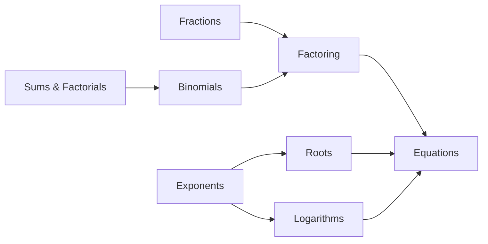

# A0 Basics MOC – Arithmetic & Algebra

> [[00 Roadmap|↑ Roadmap]] · ⚠️ [[Mistakes - Basics]]

The toolbox for everything else. If you are unsure about something in Analysis or Linear Algebra, the problem is surprisingly often here. Work through the topics in this order:

| # | Topic | What it's about | Practice |
|---|---|---|---|
| A1 | [[A1 Exponent Rules]] | powers, scientific notation, units | [[A1 Exponent Rules - Worksheet\|✏️]] · [[A1 Exponent Rules - Solutions\|✅]] |
| A2 | [[A2 Root Rules]] | roots = fractional powers, SEM, diffusion | [[A2 Root Rules - Worksheet\|✏️]] · [[A2 Root Rules - Solutions\|✅]] |
| A5 | [[A5 Fractions]] | common denominators, double fractions, Hill function | [[A5 Fractions - Worksheet\|✏️]] · [[A5 Fractions - Solutions\|✅]] |
| A4 | [[A4 Factoring and Simplifying]] | common factors, cancelling, weighted averages | [[A4 Factoring and Simplifying - Worksheet\|✏️]] · [[A4 Factoring and Simplifying - Solutions\|✅]] |
| A6 | [[A6 Binomial Formulas and Theorem]] | $(a\pm b)^2$, Pascal, quantal release | [[A6 Binomial Formulas and Theorem - Worksheet\|✏️]] · [[A6 Binomial Formulas and Theorem - Solutions\|✅]] |
| A7 | [[A7 Sums Products and Factorials]] | $\Sigma$, $\Pi$, $n!$, Poisson | [[A7 Sums Products and Factorials - Worksheet\|✏️]] · [[A7 Sums Products and Factorials - Solutions\|✅]] |
| A8 | [[A8 Solving Equations]] | linear, quadratic, exp/log, inequalities | [[A8 Solving Equations - Worksheet\|✏️]] · [[A8 Solving Equations - Solutions\|✅]] |
| A3 | [[A3 Logarithms]] | log rules, Nernst, dB, bits | [[A3 Logarithms - Worksheet\|✏️]] · [[A3 Logarithms - Solutions\|✅]] |

*(Numbers follow your topic list; the table follows the recommended learning order from the [[00 Roadmap]]. Logarithms come last here because they lead directly into [[B2 Exponential Functions]].)*

## How the topics build on each other

## Leads to
- Exponents & logs → [[B2 Exponential Functions]], [[B3 Logarithmic Functions]]
- Equations → [[C3 Linear Systems and Gaussian Elimination]]
- Sums → [[B7 Antiderivatives and Integration]], [[C1 Matrices]]
- Quadratic formula with $D < 0$ → [[E2 Complex Numbers]]

## Progress
- [ ] A1 Exponent Rules
- [ ] A2 Root Rules
- [ ] A5 Fractions
- [ ] A4 Factoring and Simplifying
- [ ] A6 Binomial Formulas
- [ ] A7 Sums, Products, Factorials
- [ ] A8 Solving Equations
- [ ] A3 Logarithms
