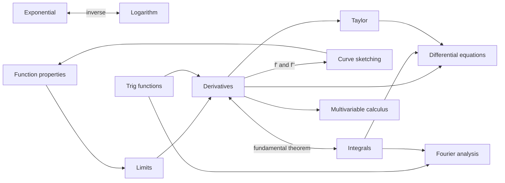

# B0 Analysis MOC – Functions & Calculus

> [[00 Roadmap|↑ Roadmap]] · ⚠️ [[Mistakes - Analysis]]

Analysis describes **change**: how membrane potentials evolve, how responses depend on stimuli, how much charge flows. Recommended order (B10–B12 at the end):

| # | Topic | What it's about | Practice |
|---|---|---|---|
| B2 | [[B2 Exponential Functions]] | $e^x$, time constants, decay | [[B2 Exponential Functions - Worksheet\|✏️]] · [[B2 Exponential Functions - Solutions\|✅]] |
| B3 | [[B3 Logarithmic Functions]] | $\ln x$, semi-log/log-log plots | [[B3 Logarithmic Functions - Worksheet\|✏️]] · [[B3 Logarithmic Functions - Solutions\|✅]] |
| B4 | [[B4 Trigonometric Functions]] | oscillations, phase, identities | [[B4 Trigonometric Functions - Worksheet\|✏️]] · [[B4 Trigonometric Functions - Solutions\|✅]] |
| B1 | [[B1 Properties of Functions]] | domain, symmetry, monotonicity, poles | [[B1 Properties of Functions - Worksheet\|✏️]] · [[B1 Properties of Functions - Solutions\|✅]] |
| B5 | [[B5 Limits and Continuity]] | limits, asymptotes, jumps | [[B5 Limits and Continuity - Worksheet\|✏️]] · [[B5 Limits and Continuity - Solutions\|✅]] |
| B6 | [[B6 Differentiation Rules]] | power, product, quotient, chain rule | [[B6 Differentiation Rules - Worksheet\|✏️]] · [[B6 Differentiation Rules - Solutions\|✅]] |
| B7 | [[B7 Antiderivatives and Integration]] | antiderivatives, FTC, substitution, parts | [[B7 Antiderivatives and Integration - Worksheet\|✏️]] · [[B7 Antiderivatives and Integration - Solutions\|✅]] |
| B8 | [[B8 Curve Sketching]] | extrema, inflection, full analysis | [[B8 Curve Sketching - Worksheet\|✏️]] · [[B8 Curve Sketching - Solutions\|✅]] |
| B9 | [[B9 Taylor Series]] | linearisation, standard series | [[B9 Taylor Series - Worksheet\|✏️]] · [[B9 Taylor Series - Solutions\|✅]] |
| B10 | [[B10 Differential Equations]] | steady state & τ, separation of variables, stability, linear systems, Euler | [[B10 Differential Equations - Worksheet\|✏️]] · [[B10 Differential Equations - Solutions\|✅]] |
| B11 | [[B11 Multivariable Calculus]] | partial derivatives, gradient, Jacobian, Hessian, double integrals | [[B11 Multivariable Calculus - Worksheet\|✏️]] · [[B11 Multivariable Calculus - Solutions\|✅]] |
| B12 | [[B12 Fourier Analysis]] | Fourier series & transform, convolution theorem, DFT, k-space | [[B12 Fourier Analysis - Worksheet\|✏️]] · [[B12 Fourier Analysis - Solutions\|✅]] |

*B10–B12 were added after the neuroscience part was written: they are the calculus that physics, biology and computer science use most (membrane equation, gradients, spectra). Do B12 after [[E2 Complex Numbers]].*

## Key connections
- **Logarithms ↔ exponentials (inverse functions):** [[B2 Exponential Functions]] ↔ [[B3 Logarithmic Functions]] ↔ [[A3 Logarithms]]
- **Derivatives ↔ antiderivatives (fundamental theorem):** [[B6 Differentiation Rules]] ↔ [[B7 Antiderivatives and Integration]]
- **Derivatives ↔ function properties (monotonicity, extrema via $f'$):** [[B6 Differentiation Rules]] → [[B1 Properties of Functions]], [[B8 Curve Sketching]]
- Trig functions ↔ unit circle: [[B4 Trigonometric Functions]] ↔ [[D4 Unit Circle Trigonometry]]
- Linearisation ↔ eigenvalues (stability): [[B9 Taylor Series]] → [[C4 Eigenvalues and Eigenvectors]] → [[B10 Differential Equations]]
- Derivatives ↔ differential equations: [[B6 Differentiation Rules]] + [[B7 Antiderivatives and Integration]] → [[B10 Differential Equations]]
- One variable ↔ many variables: [[B6 Differentiation Rules]] → [[B11 Multivariable Calculus]]
- Trig functions ↔ complex numbers ↔ Fourier: [[B4 Trigonometric Functions]] + [[E2 Complex Numbers]] → [[B12 Fourier Analysis]]

## Progress
- [ ] B2 Exponential Functions
- [ ] B3 Logarithmic Functions
- [ ] B4 Trigonometric Functions
- [ ] B1 Properties of Functions
- [ ] B5 Limits and Continuity
- [ ] B6 Differentiation Rules
- [ ] B7 Antiderivatives and Integration
- [ ] B8 Curve Sketching
- [ ] B9 Taylor Series
- [ ] B10 Differential Equations
- [ ] B11 Multivariable Calculus
- [ ] B12 Fourier Analysis
