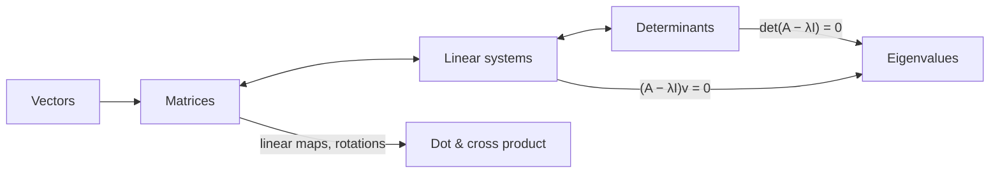

# C0 Linear Algebra MOC

> [[00 Roadmap|↑ Roadmap]] · ⚠️ [[Mistakes - Linear Algebra]]

Linear algebra is the language of **populations**: many neurons, many voxels, many weights at once. Do [[D0 Geometry and Vectors MOC|vectors]] first, then work through:

| # | Topic | What it's about | Practice |
|---|---|---|---|
| C1 | [[C1 Matrices]] | operations, transpose, inverse, connectivity | [[C1 Matrices - Worksheet\|✏️]] · [[C1 Matrices - Solutions\|✅]] |
| C2 | [[C2 Determinants]] | invertibility, volume, collinearity | [[C2 Determinants - Worksheet\|✏️]] · [[C2 Determinants - Solutions\|✅]] |
| C3 | [[C3 Linear Systems and Gaussian Elimination]] | Gauss, rank, solution types, GLM | [[C3 Linear Systems and Gaussian Elimination - Worksheet\|✏️]] · [[C3 Linear Systems and Gaussian Elimination - Solutions\|✅]] |
| C4 | [[C4 Eigenvalues and Eigenvectors]] | PCA, stability, recurrent networks | [[C4 Eigenvalues and Eigenvectors - Worksheet\|✏️]] · [[C4 Eigenvalues and Eigenvectors - Solutions\|✅]] |

## The central chain
**Matrices ↔ linear systems ↔ determinants ↔ eigenvalues** – four views of the same object:

| Statement about a square matrix $A$ | equivalent to |
|---|---|
| $A$ is invertible ([[C1 Matrices]]) | $\det A\neq0$ ([[C2 Determinants]]) |
| $A\mathbf x = \mathbf b$ has exactly one solution ([[C3 Linear Systems and Gaussian Elimination]]) | rank $= n$ |
| columns are linearly independent ([[D1 Vectors in 2D and 3D]]) | $0$ is **not** an eigenvalue ([[C4 Eigenvalues and Eigenvectors]]) |

**Vectors ↔ matrices:** a matrix is a linear map – it moves vectors. Rotations, scalings, projections ([[D1 Vectors in 2D and 3D]], [[D4 Unit Circle Trigonometry]]).

## Progress
- [ ] C1 Matrices
- [ ] C2 Determinants
- [ ] C3 Linear Systems and Gaussian Elimination
- [ ] C4 Eigenvalues and Eigenvectors
