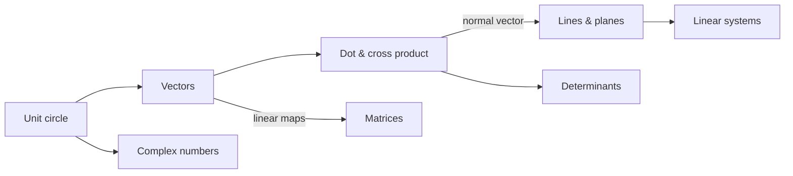

# D0 Geometry & Vectors MOC

> [[00 Roadmap|↑ Roadmap]] · ⚠️ [[Mistakes - Geometry and Vectors]]

Geometry gives you the **picture** behind linear algebra: positions in the brain, directions, angles, phases and decision boundaries. Recommended order:

| # | Topic | What it's about | Practice |
|---|---|---|---|
| D4 | [[D4 Unit Circle Trigonometry]] | special values, polar coordinates, phases | [[D4 Unit Circle Trigonometry - Worksheet\|✏️]] · [[D4 Unit Circle Trigonometry - Solutions\|✅]] |
| D1 | [[D1 Vectors in 2D and 3D]] | arithmetic, length, independence, population vector | [[D1 Vectors in 2D and 3D - Worksheet\|✏️]] · [[D1 Vectors in 2D and 3D - Solutions\|✅]] |
| D2 | [[D2 Dot and Cross Product]] | angles, projections, normals, MEG | [[D2 Dot and Cross Product - Worksheet\|✏️]] · [[D2 Dot and Cross Product - Solutions\|✅]] |
| D3 | [[D3 Lines and Planes]] | parametric/coordinate forms, distances, classifiers | [[D3 Lines and Planes - Worksheet\|✏️]] · [[D3 Lines and Planes - Solutions\|✅]] |

*D4 is best done together with [[B4 Trigonometric Functions]] (see [[00 Roadmap]]).*

## Key connections
- **Vectors ↔ matrices (linear maps, rotations):** a matrix moves vectors; rotation matrices are built from $\cos$ and $\sin$ → [[C1 Matrices]], [[D4 Unit Circle Trigonometry]]
- Dot product = weighted sum = one row of a matrix product → [[A7 Sums Products and Factorials]], [[C1 Matrices]]
- Cross product, triple product ↔ determinants → [[C2 Determinants]]
- Intersections of lines/planes = linear systems → [[C3 Linear Systems and Gaussian Elimination]]
- Unit circle ↔ trig functions ↔ complex numbers → [[B4 Trigonometric Functions]], [[E2 Complex Numbers]]

## Progress
- [ ] D4 Unit Circle Trigonometry
- [ ] D1 Vectors in 2D and 3D
- [ ] D2 Dot and Cross Product
- [ ] D3 Lines and Planes
