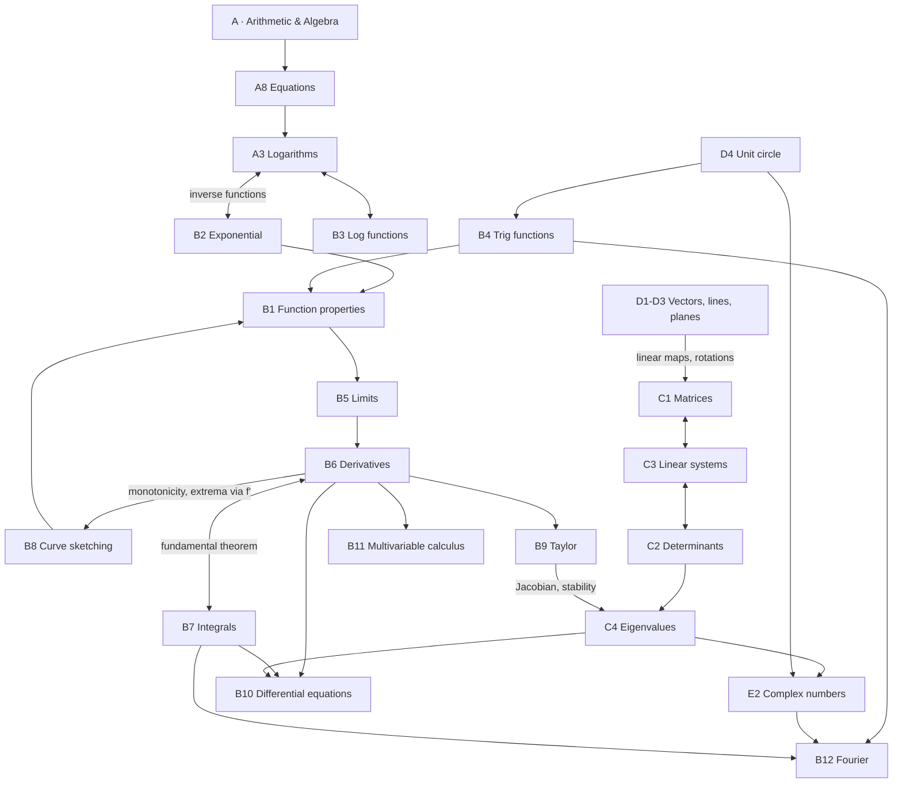

# 🧠 Math for Neuroscience – Roadmap

Welcome! This vault repeats the mathematical basics you need to understand neuroscience papers, lectures and models. Each topic has a **theory note** (rules + worked examples + neuroscience applications), a **worksheet** (easy → hard, mostly without calculator) and a **solution sheet**. Every field has a **mistake log** – the most valuable part once you start using it.

## The five fields
| Field | Map of Content | Mistake log |
|---|---|---|
| A · Arithmetic & Algebra | [[A0 Basics MOC]] | [[Mistakes - Basics]] |
| B · Functions & Analysis | [[B0 Analysis MOC]] | [[Mistakes - Analysis]] |
| C · Linear Algebra | [[C0 Linear Algebra MOC]] | [[Mistakes - Linear Algebra]] |
| D · Geometry & Vectors | [[D0 Geometry and Vectors MOC]] | [[Mistakes - Geometry and Vectors]] |
| E · Language & Cross-cutting | [[E0 Foundations MOC]] | [[Mistakes - Foundations]] |

> [!info] Beyond math
> Every math topic note now ends with a section **"Where this is used in the vault"** listing the neuroscience notes that build on it.
> Physics, chemistry, biology, methods and computer science for neuroscience live in [[MOC-neuroscience-foundations]] (physics: [[MOC-physics]]). The computer science part ([[MOC-computer-science]]) applies this math directly to neural data: SVD/PCA, statistics, ML, models. Its topic notes have `#math-link` sections pointing back here, and they show up in the backlinks of each math note. The table "Math ↔ neuroscience" there lists where each math topic is used.
> **Programming** ([[MOC-programming]]): Python, R and MATLAB put this math into code – arrays and linear algebra ([[Py05 NumPy and Arrays]]), ODE solvers and spectra ([[Py08 SciPy Scientific Computing]]), statistical models ([[R07 R Statistical Modelling]]) – and Markdown/LaTeX is how you write the formulas ([[Doc02 Math in Markdown]], [[Doc06 LaTeX Math]]). It runs best **in parallel** with the stages below.

## The learning path (13 stages)
The order matters: every stage uses the previous ones. Skim [[E1 Sets Logic and Quantifiers]] once at the start and come back whenever notation is unclear.

### Stage 1 – Arithmetic basics
[[A1 Exponent Rules]] → [[A2 Root Rules]] → [[A5 Fractions]] → [[A4 Factoring and Simplifying]] → [[A6 Binomial Formulas and Theorem]] → [[A7 Sums Products and Factorials]]
*Why first:* these are the moves you make in every single calculation. Most "I don't get calculus" problems are actually fraction or exponent problems.

### Stage 2 – Solving equations
[[A8 Solving Equations]]
*Why now:* rearranging formulas (time constants, reversal potentials, steady states) is what you'll do most. Needs all of stage 1.

### Stage 3 – Logarithms & exponential functions
[[A3 Logarithms]] → [[B2 Exponential Functions]] → [[B3 Logarithmic Functions]]
*Why now:* the most important functions in neuroscience (membrane charging, decay, Nernst, decibels). Logarithms are the **inverse** of exponentiation – learn them as a pair.

### Stage 4 – Trigonometry
[[D4 Unit Circle Trigonometry]] → [[B4 Trigonometric Functions]]
*Why now:* oscillations and phases. The unit circle gives the special values, the functions describe rhythms over time.

### Stage 5 – Properties of functions
[[B1 Properties of Functions]]
*Why now:* with exp, log and trig you know enough functions to talk about domains, symmetry, monotonicity, poles and inverses in general.

### Stage 6 – Limits & continuity
[[B5 Limits and Continuity]]
*Why now:* the bridge to calculus – derivatives and integrals are both defined as limits.

### Stage 7 – Differentiation
[[B6 Differentiation Rules]]
*Why now:* rates of change – $dV/dt$, gradients, sensitivity.

### Stage 8 – Integration
[[B7 Antiderivatives and Integration]]
*Why now:* the inverse of differentiation (fundamental theorem) – charge, spike counts, probabilities.

### Stage 9 – Curve sketching (+ Taylor series)
[[B8 Curve Sketching]] → [[B9 Taylor Series]]
*Why now:* combines everything from Analysis. Taylor series (linearisation) prepares stability analysis in stage 12.

### Stage 10 – Vectors, lines, planes
[[D1 Vectors in 2D and 3D]] → [[D2 Dot and Cross Product]] → [[D3 Lines and Planes]]
*Why now:* geometry as the visual foundation for linear algebra – brain coordinates, population vectors, decoders.

### Stage 11 – Matrices, determinants, Gauss
[[C1 Matrices]] → [[C2 Determinants]] → [[C3 Linear Systems and Gaussian Elimination]]
*Why now:* populations of neurons, connectivity, the GLM.

### Stage 12 – Eigenvalues & eigenvectors (+ complex numbers)
[[C4 Eigenvalues and Eigenvectors]] → [[E2 Complex Numbers]]
*Why here:* needs determinants, linear systems and (for stability) derivatives. Payoff: PCA, network stability, oscillations. Complex numbers are no longer optional: they are needed for Fourier analysis (stage 13).

### Stage 13 – Applied calculus: the bridge to neuroscience
[[B10 Differential Equations]] → [[B11 Multivariable Calculus]] → [[B12 Fourier Analysis]]
*Why last:* these combine everything before (derivatives, integrals, eigenvalues, complex numbers) and are exactly the tools the neuroscience part uses most: the membrane equation and Hodgkin–Huxley (ODEs), gradient descent and Jacobians (multivariable), EEG spectra, filters and MRI k-space (Fourier). If you go through the neuroscience notes in parallel, do **B10 before** [[Ph05 Capacitance and RC Circuits]] / [[Bio05 Neurons and Action Potentials]].

## The big connections

| Connection | Notes |
|---|---|
| Logarithms ↔ exponential functions (inverse functions) | [[A3 Logarithms]] · [[B2 Exponential Functions]] · [[B3 Logarithmic Functions]] |
| Derivatives ↔ antiderivatives (fundamental theorem) | [[B6 Differentiation Rules]] · [[B7 Antiderivatives and Integration]] |
| Matrices ↔ linear systems ↔ determinants ↔ eigenvalues | [[C1 Matrices]] · [[C3 Linear Systems and Gaussian Elimination]] · [[C2 Determinants]] · [[C4 Eigenvalues and Eigenvectors]] |
| Vectors ↔ matrices (linear maps, rotations) | [[D1 Vectors in 2D and 3D]] · [[C1 Matrices]] · [[D4 Unit Circle Trigonometry]] |
| Derivatives ↔ function properties (monotonicity, extrema via $f'$) | [[B6 Differentiation Rules]] · [[B1 Properties of Functions]] · [[B8 Curve Sketching]] |
| Unit circle ↔ trig functions ↔ complex numbers | [[D4 Unit Circle Trigonometry]] · [[B4 Trigonometric Functions]] · [[E2 Complex Numbers]] |
| Derivatives ↔ differential equations ↔ eigenvalues | [[B6 Differentiation Rules]] · [[B10 Differential Equations]] · [[C4 Eigenvalues and Eigenvectors]] |
| Trig ↔ complex numbers ↔ Fourier analysis | [[B4 Trigonometric Functions]] · [[E2 Complex Numbers]] · [[B12 Fourier Analysis]] |
| Sums ↔ integrals ↔ dot products | [[A7 Sums Products and Factorials]] · [[B7 Antiderivatives and Integration]] · [[D2 Dot and Cross Product]] |

## How to work with this vault
1. **Read** the theory note. Cover the worked examples and try them yourself first.
2. **Do the worksheet** on paper. No calculator (except tasks marked 🧮).
3. **Check** with the solution sheet – compare *steps*, not just results.
4. **Log every mistake** in the field's mistake log (template: [[Mistake Entry Template]]). Write *why* it was wrong and a quick test that would have caught it.
5. **Tick off** the topic in the progress list below and in the field's MOC.
6. **Revisit** the mistake logs weekly and before exams.
7. For lecture notes use [[Lecture Note Template]] (tag `#lecture`) and link them to the topic notes – the links then show up in the topic's backlinks.

> [!tip] Obsidian views
> - **Graph view** (colour groups by tag or path) shows the connections between topics.
> - **Backlinks** pane on a topic note: everything that references it, including your mistakes and lecture notes.
> - **Tag pane:** cross-sectional overviews, e.g. all notes tagged `#derivative`.

## Tags
| Tag | Meaning |
|---|---|
| `#type/overview`, `#type/worksheet`, `#type/solution`, `#type/mistakes`, `#type/moc` | kind of note |
| `#basics`, `#analysis`, `#linear-algebra`, `#geometry`, `#foundations` | field |
| `#neuro` | sections with neuroscience applications |
| `#lecture` | your own lecture notes |
| `#exponent` `#root` `#logarithm` `#factoring` `#fraction` `#binomial` `#summation` `#factorial` `#equation` | topics in A |
| `#function` `#exponential` `#trigonometry` `#limit` `#continuity` `#derivative` `#integral` `#curve-sketching` `#taylor` `#differential-equation` `#multivariable` `#gradient` `#fourier` | topics in B |
| `#matrix` `#determinant` `#linear-system` `#eigenvalue` | topics in C |
| `#vector` `#dot-product` `#cross-product` `#plane` `#unit-circle` | topics in D |
| `#set` `#logic` `#complex` | topics in E |
| `#mistake/sign`, `#mistake/rule`, `#mistake/careless`, `#mistake/concept` | suggested tags for your own mistake entries |

## Progress
- [ ] Stage 1 – Arithmetic basics
- [ ] Stage 2 – Solving equations
- [ ] Stage 3 – Logarithms & exponential functions
- [ ] Stage 4 – Trigonometry
- [ ] Stage 5 – Properties of functions
- [ ] Stage 6 – Limits & continuity
- [ ] Stage 7 – Differentiation
- [ ] Stage 8 – Integration
- [ ] Stage 9 – Curve sketching & Taylor series
- [ ] Stage 10 – Vectors, lines, planes
- [ ] Stage 11 – Matrices, determinants, Gauss
- [ ] Stage 12 – Eigenvalues & complex numbers
- [ ] Stage 13 – Differential equations, multivariable calculus, Fourier
