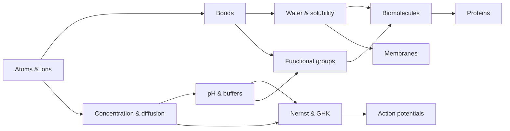

# MOC – Chemistry for Neuroscience

> [[MOC-neuroscience-foundations|↑ Neuroscience Foundations]] · ⚠️ [[Mistakes - Chemistry]] · Math: [[00 Roadmap]]

## What this field is about
Chemistry explains the **raw material** of the nervous system. Neurons are electrochemical machines: they keep ions unequally distributed across a lipid membrane and use that stored energy for signalling. To understand this you need four ideas, which the notes build up in order:
1. **Matter is charged:** atoms form ions with specific charges and sizes (Ch01).
2. **Interactions decide structure:** strong bonds hold molecules together; weak, reversible interactions and water decide folding, binding and membranes (Ch02, Ch03).
3. **Gradients store energy:** pH, concentration and electrical gradients, and the Nernst and GHK equations (Ch04–Ch06).
4. **Molecules have shape and function:** functional groups, chirality and the four classes of biomolecules (Ch07, Ch08).

## Topics
| # | Topic | Key idea | Practice |
|---|---|---|---|
| Ch01 | [[Ch01 Atomic Structure]] | shells, valence, electronegativity, ions | [[Ch01 Atomic Structure - Worksheet\|✏️]] · [[Ch01 Atomic Structure - Solutions\|✅]] |
| Ch02 | [[Ch02 Chemical Bonds]] | covalent, ionic, H-bond, hydrophobic, coordinate | [[Ch02 Chemical Bonds - Worksheet\|✏️]] · [[Ch02 Chemical Bonds - Solutions\|✅]] |
| Ch03 | [[Ch03 Intermolecular Forces and Solubility]] | water, hydration, amphiphiles, BBB | [[Ch03 Intermolecular Forces and Solubility - Worksheet\|✏️]] · [[Ch03 Intermolecular Forces and Solubility - Solutions\|✅]] |
| Ch04 | [[Ch04 Acids Bases and pH]] | pH, Henderson–Hasselbalch, bicarbonate | [[Ch04 Acids Bases and pH - Worksheet\|✏️]] · [[Ch04 Acids Bases and pH - Solutions\|✅]] |
| Ch05 | [[Ch05 Redox and Electrochemistry]] | **Nernst, GHK**, driving force, ATP | [[Ch05 Redox and Electrochemistry - Worksheet\|✏️]] · [[Ch05 Redox and Electrochemistry - Solutions\|✅]] |
| Ch06 | [[Ch06 Solutions and Concentration]] | molarity, osmolarity, diffusion | [[Ch06 Solutions and Concentration - Worksheet\|✏️]] · [[Ch06 Solutions and Concentration - Solutions\|✅]] |
| Ch07 | [[Ch07 Organic Chemistry Essentials]] | functional groups, chirality | [[Ch07 Organic Chemistry Essentials - Worksheet\|✏️]] · [[Ch07 Organic Chemistry Essentials - Solutions\|✅]] |
| Ch08 | [[Ch08 Biomolecules]] | amino acids, sugars, lipids, nucleotides | [[Ch08 Biomolecules - Worksheet\|✏️]] · [[Ch08 Biomolecules - Solutions\|✅]] |

**Suggested order:** Ch01 → Ch02 → Ch03 → Ch06 → Ch04 → Ch05 → Ch07 → Ch08. Concentrations (Ch06) come before pH and Nernst because both use them. Ch05 is the most important note in this field.

## Bridges
- **To biology:**
  - [[Ch05 Redox and Electrochemistry]] → [[Bio05 Neurons and Action Potentials]]
  - [[Ch03 Intermolecular Forces and Solubility]] → [[Bio02 Membranes and Transport]]
  - [[Ch08 Biomolecules]] → [[Bio03 Proteins and Enzymes]], [[Bio04 Nucleic Acids and Gene Expression]]
- **To math:**
  - logarithms ([[A3 Logarithms]]) for pH, p$K_a$, Nernst, GHK and log P
  - square roots ([[A2 Root Rules]]) for diffusion
  - exponentials ([[B2 Exponential Functions]]) for the Boltzmann factor
  - fractions ([[A5 Fractions]]) for GHK and weighted averages
- **To methods:**
  - pHluorin and electrophysiology solutions → [[Meth03 Electrophysiology]]
  - isotopes → [[Meth04 In Vivo Imaging]]
  - detergents and H-bonds in PCR → [[Meth05 Molecular Biology Tools]]

## Progress
- [ ] Ch01 Atomic Structure
- [ ] Ch02 Chemical Bonds
- [ ] Ch03 Intermolecular Forces and Solubility
- [ ] Ch06 Solutions and Concentration
- [ ] Ch04 Acids, Bases and pH
- [ ] Ch05 Redox and Electrochemistry
- [ ] Ch07 Organic Chemistry Essentials
- [ ] Ch08 Biomolecules
