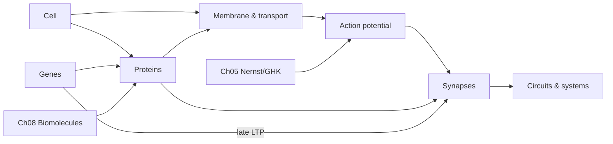

# MOC – Biology for Neuroscience

> [[MOC-neuroscience-foundations|↑ Neuroscience Foundations]] · ⚠️ [[Mistakes - Biology]] · Chemistry: [[MOC-chemistry]]

## What this field is about
Biology takes the molecules from chemistry and builds the **machine**. The notes zoom out step by step:
1. **The cell** and its organelles, cytoskeleton and vesicles (Bio01)
2. **The membrane** as the place of pumps and channels (Bio02)
3. **Proteins** as the working molecules: structure, enzymes, receptors, misfolding (Bio03)
4. **Genes** and how expression, epigenetics and splicing make neurons diverse (Bio04)
5. **The neuron** and its electrical signal, the action potential (Bio05)
6. **The synapse** for communication and learning (Bio06)
7. **Circuits and systems**: anatomy, development, glia (Bio07)

## Topics
| # | Topic | Key idea | Practice |
|---|---|---|---|
| Bio01 | [[Bio01 Cell Biology]] | organelles, cytoskeleton, axonal transport, SNAREs | [[Bio01 Cell Biology - Worksheet\|✏️]] · [[Bio01 Cell Biology - Solutions\|✅]] |
| Bio02 | [[Bio02 Membranes and Transport]] | bilayer, channels, pumps, transporters | [[Bio02 Membranes and Transport - Worksheet\|✏️]] · [[Bio02 Membranes and Transport - Solutions\|✅]] |
| Bio03 | [[Bio03 Proteins and Enzymes]] | structure levels, misfolding, Michaelis–Menten, GPCRs | [[Bio03 Proteins and Enzymes - Worksheet\|✏️]] · [[Bio03 Proteins and Enzymes - Solutions\|✅]] |
| Bio04 | [[Bio04 Nucleic Acids and Gene Expression]] | replication, transcription, translation, epigenetics, splicing | [[Bio04 Nucleic Acids and Gene Expression - Worksheet\|✏️]] · [[Bio04 Nucleic Acids and Gene Expression - Solutions\|✅]] |
| Bio05 | [[Bio05 Neurons and Action Potentials]] | resting potential, AP phases, refractoriness, myelin | [[Bio05 Neurons and Action Potentials - Worksheet\|✏️]] · [[Bio05 Neurons and Action Potentials - Solutions\|✅]] |
| Bio06 | [[Bio06 Synapses and Neurotransmitters]] | release, transmitters, receptors, LTP/LTD | [[Bio06 Synapses and Neurotransmitters - Worksheet\|✏️]] · [[Bio06 Synapses and Neurotransmitters - Solutions\|✅]] |
| Bio07 | [[Bio07 Neural Circuits and Systems]] | anatomy, basal ganglia, hippocampus, development, glia | [[Bio07 Neural Circuits and Systems - Worksheet\|✏️]] · [[Bio07 Neural Circuits and Systems - Solutions\|✅]] |

**Suggested order:** as numbered. Do [[Ch05 Redox and Electrochemistry]] before Bio05 and [[Ch08 Biomolecules]] before Bio03 and Bio04.

## Recurring themes across notes
- **Ion channels:** structure in [[Bio02 Membranes and Transport]] → AP in [[Bio05 Neurons and Action Potentials]] → receptors in [[Bio06 Synapses and Neurotransmitters]] → channelopathies.
- **Ca²⁺ as universal signal:** release ([[Bio06 Synapses and Neurotransmitters]]), plasticity, gene expression ([[Bio04 Nucleic Acids and Gene Expression]]), excitotoxicity.
- **Protein homeostasis and neurodegeneration:** [[Bio01 Cell Biology]] (transport, autophagy) + [[Bio03 Proteins and Enzymes]] (misfolding).
- **Dopamine:** synthesis ([[Ch07 Organic Chemistry Essentials]]), D1/D2 GPCRs ([[Bio03 Proteins and Enzymes]]), basal ganglia ([[Bio07 Neural Circuits and Systems]]), PET ([[Meth04 In Vivo Imaging]]).

## Bridges to math
- Membrane equation and AP models → [[B2 Exponential Functions]], [[B6 Differentiation Rules]], [[B9 Taylor Series]]
- Saturation and binding curves → [[A5 Fractions]], [[B8 Curve Sketching]]
- Quantal release → [[A6 Binomial Formulas and Theorem]]
- Networks → [[C1 Matrices]], [[C4 Eigenvalues and Eigenvectors]]

## Progress
- [ ] Bio01 Cell Biology
- [ ] Bio02 Membranes and Transport
- [ ] Bio03 Proteins and Enzymes
- [ ] Bio04 Nucleic Acids and Gene Expression
- [ ] Bio05 Neurons and Action Potentials
- [ ] Bio06 Synapses and Neurotransmitters
- [ ] Bio07 Neural Circuits and Systems
