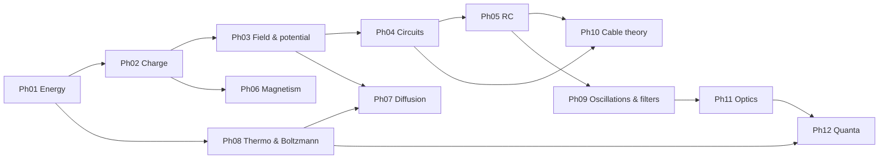

# MOC – Physics for Neuroscience

> [[MOC-neuroscience-foundations|↑ Neuroscience Foundations]] · ⚠️ [[Mistakes - Physics]] · Chemistry: [[MOC-chemistry]] · Math: [[00 Roadmap]]

## What this field is about
Physics provides the **laws behind the numbers** in neuroscience. The notes start with school physics (force, energy, charge, current) and build up to the physics of the neuron: the membrane is a capacitor, channels are resistors, gradients are batteries. Signals spread like heat in a leaky cable, and thermal noise sets the probability of every molecular event. The last part covers the physics of light used in imaging and optogenetics.

The notes fall into four blocks:
1. **Foundations** (school level): mechanics and energy, charge and current (Ph01–Ph02)
2. **Electricity of the neuron**: fields and potential, circuits, capacitance and RC, cables (Ph03–Ph05, Ph10)
3. **Molecular physics**: diffusion, thermodynamics and statistics (Ph07–Ph08)
4. **Fields and waves for methods**: magnetism and induction, oscillations, optics, quanta (Ph06, Ph09, Ph11, Ph12)

## Topics
| # | Topic | Key idea | Practice |
|---|---|---|---|
| Ph01 | [[Ph01 Mechanics and Energy]] | F = ma, work, energy conservation, pN and kT | [[Ph01 Mechanics and Energy - Worksheet\|✏️]] · [[Ph01 Mechanics and Energy - Solutions\|✅]] |
| Ph02 | [[Ph02 Electricity and Charge]] | e, Coulomb, current vs. voltage, ions | [[Ph02 Electricity and Charge - Worksheet\|✏️]] · [[Ph02 Electricity and Charge - Solutions\|✅]] |
| Ph03 | [[Ph03 Electric Fields and Potential]] | E = F/q, membrane field, equilibrium potential | [[Ph03 Electric Fields and Potential - Worksheet\|✏️]] · [[Ph03 Electric Fields and Potential - Solutions\|✅]] |
| Ph04 | [[Ph04 Circuits and Resistance]] | Ohm, series/parallel, Kirchhoff, equivalent circuit | [[Ph04 Circuits and Resistance - Worksheet\|✏️]] · [[Ph04 Circuits and Resistance - Solutions\|✅]] |
| Ph05 | [[Ph05 Capacitance and RC Circuits]] | C = Q/V, τ = RC, leaky integrate-and-fire | [[Ph05 Capacitance and RC Circuits - Worksheet\|✏️]] · [[Ph05 Capacitance and RC Circuits - Solutions\|✅]] |
| Ph06 | [[Ph06 Magnetism and Induction]] | B from currents, Faraday, TMS, MEG | [[Ph06 Magnetism and Induction - Worksheet\|✏️]] · [[Ph06 Magnetism and Induction - Solutions\|✅]] |
| Ph07 | [[Ph07 Diffusion and Transport]] | Fick, Stokes–Einstein, Nernst–Planck, osmosis | [[Ph07 Diffusion and Transport - Worksheet\|✏️]] · [[Ph07 Diffusion and Transport - Solutions\|✅]] |
| Ph08 | [[Ph08 Thermodynamics and Statistics]] | kT, Boltzmann, ΔG, entropy | [[Ph08 Thermodynamics and Statistics - Worksheet\|✏️]] · [[Ph08 Thermodynamics and Statistics - Solutions\|✅]] |
| Ph09 | [[Ph09 Waves and Oscillations]] | f, phase, Fourier, EEG bands, filters | [[Ph09 Waves and Oscillations - Worksheet\|✏️]] · [[Ph09 Waves and Oscillations - Solutions\|✅]] |
| Ph10 | [[Ph10 Signal Propagation and Cable Theory]] | λ, cable equation, myelin, Hodgkin–Huxley | [[Ph10 Signal Propagation and Cable Theory - Worksheet\|✏️]] · [[Ph10 Signal Propagation and Cable Theory - Solutions\|✅]] |
| Ph11 | [[Ph11 Optics and Fluorescence]] | Snell, lenses, Abbe, fluorescence, bleaching | [[Ph11 Optics and Fluorescence - Worksheet\|✏️]] · [[Ph11 Optics and Fluorescence - Solutions\|✅]] |
| Ph12 | [[Ph12 Quantum Basics for Biophysics]] | E = hf, energy levels, tunnelling | [[Ph12 Quantum Basics for Biophysics - Worksheet\|✏️]] · [[Ph12 Quantum Basics for Biophysics - Solutions\|✅]] |

**Suggested order:** Ph01 → Ph02 → Ph03 → Ph04 → Ph05 → Ph07 → Ph08 → Ph10 → Ph09 → Ph06 → Ph11 → Ph12. The electrical block (Ph02–Ph05) should come **early**, before [[Ch05 Redox and Electrochemistry]] and [[Bio05 Neurons and Action Potentials]] (see [[MOC-neuroscience-foundations]]).

## Connections to the other sections
| Connection | Notes |
|---|---|
| **Coulomb's law ↔ ionic bonds ↔ electrochemistry** | [[Ph02 Electricity and Charge]] · [[Ch02 Chemical Bonds]] · [[Ch03 Intermolecular Forces and Solubility]] · [[Ch05 Redox and Electrochemistry]] |
| **RC circuit ↔ membrane capacitance ↔ action potential timing** | [[Ph05 Capacitance and RC Circuits]] · [[Bio02 Membranes and Transport]] · [[Bio05 Neurons and Action Potentials]] |
| **Ohm's law ↔ ion channel conductance ↔ membrane resistance** | [[Ph04 Circuits and Resistance]] · [[Bio02 Membranes and Transport]] · [[Meth03 Electrophysiology]] |
| **Nernst equation ↔ thermodynamics (ΔG) ↔ ion gradients** | [[Ph08 Thermodynamics and Statistics]] · [[Ph03 Electric Fields and Potential]] · [[Ph07 Diffusion and Transport]] · [[Ch05 Redox and Electrochemistry]] |
| **Boltzmann distribution ↔ channel gating ↔ synaptic release probability** | [[Ph08 Thermodynamics and Statistics]] · [[Bio02 Membranes and Transport]] · [[Bio06 Synapses and Neurotransmitters]] |
| **Cable equation ↔ dendritic integration ↔ axon conduction ↔ myelin** | [[Ph10 Signal Propagation and Cable Theory]] · [[Bio05 Neurons and Action Potentials]] · [[Bio07 Neural Circuits and Systems]] |
| **Faraday's law ↔ TMS ↔ MEG** | [[Ph06 Magnetism and Induction]] · [[Meth03 Electrophysiology]] · [[Meth04 In Vivo Imaging]] |
| **Fourier analysis ↔ EEG rhythms ↔ signal processing in electrophysiology** | [[Ph09 Waves and Oscillations]] · [[Meth03 Electrophysiology]] · [[E2 Complex Numbers]] |
| **Diffraction limit ↔ super-resolution microscopy ↔ fluorescence** | [[Ph11 Optics and Fluorescence]] · [[Meth01 Microscopy]] |
| **Photon energy ↔ optogenetics ↔ fluorescent indicators** | [[Ph12 Quantum Basics for Biophysics]] · [[Meth05 Molecular Biology Tools]] · [[Meth04 In Vivo Imaging]] |
| Diffusion ↔ Fick ↔ osmosis ↔ diffusion MRI | [[Ph07 Diffusion and Transport]] · [[Ch06 Solutions and Concentration]] · [[Meth04 In Vivo Imaging]] |

## Bridges to computer science
- RC circuit → leaky integrate-and-fire models → [[CS10 Dynamical and Computational Neuro Models]]
- Fourier, filters, sampling → [[CS11 Time Series and Signal Processing]]
- Boltzmann/Shannon entropy → [[CS03 Information Theory]]
- MEG/EEG forward models → source localisation → [[CS12 Neuroimaging Data Analysis]]

## Bridges to math
| Physics | Math |
|---|---|
| RC charging, cable decay, Boltzmann factors, radioactive decay | [[B2 Exponential Functions]] |
| Nernst, ΔG° = −RT ln K, decibels, log spectra | [[A3 Logarithms]] |
| $I = C\,dV/dt$, Fick's law, Faraday's law, cable equation | [[B6 Differentiation Rules]] |
| Charge = ∫ I dt, work = ∫ F dx, Fourier transform | [[B7 Antiderivatives and Integration]] |
| Diffusion distance $\sqrt{2Dt}$, λ = $\sqrt{r_m/r_i}$, shot noise $\sqrt N$ | [[A2 Root Rules]] |
| Parallel conductances, weighted averages, lens equation | [[A5 Fractions]], [[A4 Factoring and Simplifying]] |
| Oscillations, phase, Snell's law, NA | [[B4 Trigonometric Functions]], [[D4 Unit Circle Trigonometry]] |
| Forces and fields as vectors, Lorentz force, MEG dipoles | [[D1 Vectors in 2D and 3D]], [[D2 Dot and Cross Product]] |
| Kirchhoff networks, compartment models | [[C3 Linear Systems and Gaussian Elimination]] |
| Fourier coefficients (amplitude & phase) | [[E2 Complex Numbers]] |

## Progress
- [ ] Ph01 Mechanics and Energy
- [ ] Ph02 Electricity and Charge
- [ ] Ph03 Electric Fields and Potential
- [ ] Ph04 Circuits and Resistance
- [ ] Ph05 Capacitance and RC Circuits
- [ ] Ph07 Diffusion and Transport
- [ ] Ph08 Thermodynamics and Statistics
- [ ] Ph10 Signal Propagation and Cable Theory
- [ ] Ph09 Waves and Oscillations
- [ ] Ph06 Magnetism and Induction
- [ ] Ph11 Optics and Fluorescence
- [ ] Ph12 Quantum Basics for Biophysics
