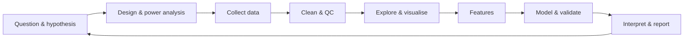

# CS06 Data Science Workflow

> [[MOC-computer-science|↑ CS MOC]] · [[CS06 Data Science Workflow - Worksheet|✏️ Worksheet]] · [[CS06 Data Science Workflow - Solutions|✅ Solutions]] · [[Mistakes - Computer Science|⚠️ Mistake log]]

## Why this matters
Most errors in data analysis don't come from fancy models. They come from the **workflow**: dirty data, information leaking from the test set, analysis choices made after looking at the results, or too few samples. A careful workflow is what makes a finding trustworthy, and it is where many neuroscience results have failed to replicate.

## The workflow at a glance

Decide as much as possible **before** seeing the outcome data (preregistration, [[CS13 Reproducibility and Research Software]]).

## Data cleaning, missing values, outliers
**Quality control first:** check ranges and units, sampling rates, duplicates, impossible values (negative firing rates), recording artefacts (motion, electrode drift), and that trial labels match the event times.

**Missing values**
| Mechanism | Meaning | Consequence |
|---|---|---|
| MCAR (missing completely at random) | missingness unrelated to anything | deleting cases loses power but doesn't bias |
| MAR (missing at random) | depends on observed variables | can be handled by modelling or imputation using those variables |
| MNAR (not at random) | depends on the missing value itself (e.g. sickest patients drop out) | biased whatever you do; needs sensitivity analyses |

- **Options:** complete-case analysis, simple imputation (mean/median, which shrinks variance), model-based or multiple imputation, models that handle missing data (mixed models).
- **Never** silently encode missing values as 0 or −999.

**Outliers**
- Detect with z-scores ($\lvert z\rvert > 3$), the **IQR rule** (below $Q_1 - 1.5\,\text{IQR}$ or above $Q_3 + 1.5\,\text{IQR}$), or robust z-scores using the **median** and **MAD** (median absolute deviation; the mean and SD are themselves distorted by outliers).
- **Decide why** a point is extreme: an artefact (remove, with documented criteria) or a real but rare event (keep; use robust statistics).
- Exclusion criteria should be defined **before** the analysis, applied equally to all conditions and reported.

## Feature engineering and selection
- **Features** are the numbers fed into a model.
  - spike counts in time bins; firing rate after stimulus onset
  - band power (alpha, gamma)
  - waveform width
  - voxel activations; connectivity values
  - pose coordinates from video
- **Transformations:**
  - standardisation (z-score: $\frac{x - \mu}{\sigma}$)
  - log transforms for skewed variables (firing rates, reaction times)
  - square root for counts (variance stabilisation)
  - baseline normalisation ($\Delta F/F$)
- **Feature selection:**
  - filter methods (univariate tests, variance)
  - wrapper methods (search over subsets)
  - embedded methods (L1 regularisation, tree importances)
  - **Selection must happen inside the cross-validation loop** (see leakage).
- **Curse of dimensionality:** with many features and few samples ($p\gg n$, e.g. 50,000 voxels, 100 trials), almost anything can be fitted perfectly, so regularise and validate.

## Train, validation and test splits; cross-validation
| Set | Role |
|---|---|
| **Training** | fit model parameters |
| **Validation** | choose hyperparameters (λ, model type, number of features) |
| **Test** | final, **one-time** estimate of performance on unseen data |

**k-fold cross-validation:**
1. Split the data into $k$ folds (e.g. 5 or 10).
2. Train on $k - 1$ folds, test on the remaining one; rotate.
3. Average the performance.

This uses all data for both training and testing, but never at the same time.
- **Nested CV:** an inner loop chooses the hyperparameters and an outer loop estimates performance. Without it, the CV score of the best hyperparameter setting is optimistically biased.
- **Grouped / blocked CV:** split by **independent units**: by subject (leave-one-subject-out), by session, by fMRI run, by time blocks for time series. Neighbouring time points, trials from the same session and cells from the same animal are **not independent**.
- **Stratification:** keep class proportions similar across folds.

## Data leakage and how to avoid it
**Leakage** = information from the test data influencing the training. It gives inflated, non-replicable performance.
| Leak | Example | Fix |
|---|---|---|
| Preprocessing on all data | z-scoring or PCA fitted on the full dataset before splitting | fit preprocessing on training folds only, then apply it to the test fold (pipelines) |
| Feature selection on all data | picking the "most responsive voxels" using all trials, then decoding | select inside each training fold |
| Non-independent splits | trials from the same session or subject in both train and test; overlapping time windows | grouped/blocked CV |
| Temporal leakage | random split of autocorrelated time series; predicting the past from the future | forward-chaining / blocked CV |
| Duplicates | the same sample twice (augmented copies) on both sides | deduplicate before splitting |
| **Double dipping** (circular analysis) | defining an ROI by a contrast and then testing the same contrast in that ROI with the same data (Kriegeskorte et al. 2009; Vul et al. 2009, "voodoo correlations") | independent data for selection and testing |

## Exploratory data analysis and visualisation
- **Look at raw data first:** traces, rasters, single trials, images. Summary statistics can hide structure. **Anscombe's quartet** shows four datasets with identical means, variances, correlations and regression lines that look completely different.
- **Show distributions**, not just bars: individual data points, box/violin plots, histograms. Bar plots of means hide the data.
- **Error bars:** SD (spread of the data), SEM (precision of the mean, SD/√n), or 95 % CI. Always **say which**. SEM bars look small and are often misread.
- **Colour:** use perceptually uniform colour maps (viridis) instead of rainbow/jet (which creates false boundaries); make plots colour-blind-safe; use diverging maps for signed data centred on 0.
- **Axes:** label with units; start bar charts at zero; be careful with dual axes; use log scales for multiplicative data.
- **Exploration vs. confirmation:** patterns found during exploration are **hypotheses** that need independent testing.

## Sample size and statistical power
- **Power** = probability of detecting a true effect $= 1 - \beta$. It depends on the **effect size**, the **sample size**, α, and the noise/design (paired designs are stronger).
- For a two-sample t-test with α = 0.05 and power 0.8, you need roughly $n\approx\frac{16}{d^2}$ per group: $d = 0.5$ needs ~64 per group; $d = 0.8$ needs ~26. Halving the effect size **quadruples** the required $n$.
- **Low power** has three costs:
  - missed effects
  - **inflated effect sizes** among significant results (the "winner's curse")
  - a lower probability that a significant result is true (positive predictive value; [[CS02 Probability and Statistics]], base rates)

  The median power in neuroscience studies has been estimated at ~20 % (Button et al. 2013).
- **What is $n$?** Animals, subjects or cells? The unit of inference must match the unit of randomisation (pseudoreplication).
- Do power analyses **before** collecting data, and base them on realistic (not inflated pilot) effect sizes.

## In neuroscience #neuro
- **Decoding studies:** use cross-validation across runs or sessions, permutation tests for chance level, and report balanced accuracy.
- **Brain–behaviour correlations** with small $n$ (e.g. 20 subjects) are unstable. Brain-wide association studies need thousands of participants for reliable effects (Marek et al. 2022).
- **Spike sorting, ROI detection and motion correction** are preprocessing steps with many parameters. Report them and check how robust the results are to them.

## Math links #math-link
- Mean, median, quantiles, z-scores → [[A7 Sums Products and Factorials]]
- SEM $= \sigma/\sqrt n$; $n\propto1/d^2$ → [[A2 Root Rules]]
- Log transforms → [[B3 Logarithmic Functions]]
- Logic of necessary/sufficient and circularity → [[E1 Sets Logic and Quantifiers]]

## Connections
- In code → [[Py06 pandas and Tabular Data]], [[Py07 Python Plotting and Visualization]], [[Py09 Python Machine Learning Libraries]] (pipelines, grouped CV), [[R05 dplyr and tidyr]]
- Statistics, tests, power, multiple comparisons → [[CS02 Probability and Statistics]]
- Regularisation and bias–variance → [[CS04 Optimization]]
- Models and metrics → [[CS07 Machine Learning Fundamentals]]
- Decoding and RSA → [[CS12 Neuroimaging Data Analysis]]
- Reproducibility, preregistration → [[CS13 Reproducibility and Research Software]]

## Key takeaways
- QC first; classify missingness (MCAR/MAR/MNAR); handle outliers with pre-defined, robust criteria (median, MAD, IQR).
- Train/validation/test; k-fold CV; nested CV for hyperparameters; grouped CV by subject, session or time.
- Leakage (preprocessing, feature selection or non-independent splits across the boundary) inflates results; so does double dipping.
- Plot raw data and distributions; say what error bars mean; use perceptually uniform colours.
- Power depends on effect size and $n$ ($n\propto1/d^2$). Underpowered studies give inflated, unreliable effects.
