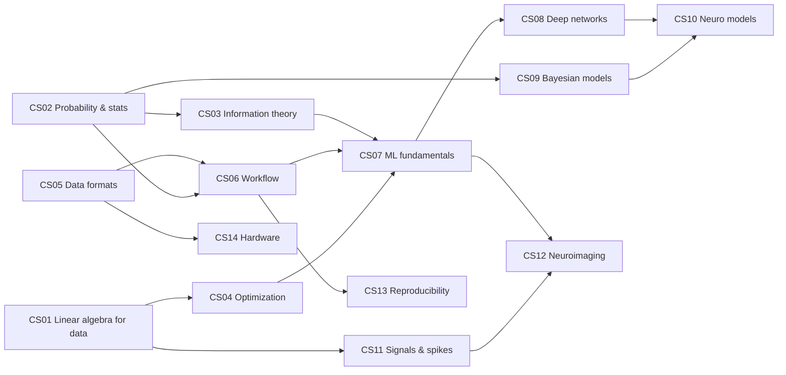

# MOC – Computer Science for Neuroscience

> [[MOC-neuroscience-foundations|↑ Neuroscience Foundations]] · ⚠️ [[Mistakes - Computer Science]] · Math: [[00 Roadmap]] · Physics: [[MOC-physics]] · Programming: [[MOC-programming]]

## What this field is about
This part is about the **concepts behind software**, not programming itself. The maths of data and models, how data are stored, how analyses are validated, how machine learning and computational models work, and how research software stays reproducible. It is deliberately mathematical: most topics apply the math notes (linear algebra, calculus, probability) to real neuroscience data. Hardware is a small side topic.

The notes fall into five blocks:
1. **Mathematical toolkit:** linear algebra for data, probability and statistics, information theory, optimisation (CS01–CS04)
2. **Data handling:** formats and metadata, the data-science workflow (CS05–CS06)
3. **Learning machines:** classical ML, deep networks, probabilistic models (CS07–CS09)
4. **Models and analysis of the brain:** computational neuroscience models, time-series and spike analysis, neuroimaging analysis (CS10–CS12)
5. **Infrastructure:** reproducibility, ethics and research software; hardware (CS13–CS14)

## Topics
| # | Topic | Key idea | Practice |
|---|---|---|---|
| CS01 | [[CS01 Mathematical Foundations]] | tensors, $Wx + b$, SVD, PCA, norms, Jacobians | [[CS01 Mathematical Foundations - Worksheet\|✏️]] · [[CS01 Mathematical Foundations - Solutions\|✅]] |
| CS02 | [[CS02 Probability and Statistics]] | distributions, Bayes, MLE/MAP, tests, FDR, bootstrap | [[CS02 Probability and Statistics - Worksheet\|✏️]] · [[CS02 Probability and Statistics - Solutions\|✅]] |
| CS03 | [[CS03 Information Theory]] | entropy, mutual information, KL, cross-entropy, neural codes | [[CS03 Information Theory - Worksheet\|✏️]] · [[CS03 Information Theory - Solutions\|✅]] |
| CS04 | [[CS04 Optimization]] | losses, SGD/Adam, convexity, L1/L2, bias–variance, Lagrange | [[CS04 Optimization - Worksheet\|✏️]] · [[CS04 Optimization - Solutions\|✅]] |
| CS05 | [[CS05 Data Formats and Representation]] | tidy data, HDF5/Zarr, NWB, BIDS, TIFF/DICOM, dtypes, metadata | [[CS05 Data Formats and Representation - Worksheet\|✏️]] · [[CS05 Data Formats and Representation - Solutions\|✅]] |
| CS06 | [[CS06 Data Science Workflow]] | cleaning, features, CV, leakage, EDA, power | [[CS06 Data Science Workflow - Worksheet\|✏️]] · [[CS06 Data Science Workflow - Solutions\|✅]] |
| CS07 | [[CS07 Machine Learning Fundamentals]] | regression, logistic, SVM, trees, clustering, metrics | [[CS07 Machine Learning Fundamentals - Worksheet\|✏️]] · [[CS07 Machine Learning Fundamentals - Solutions\|✅]] |
| CS08 | [[CS08 Deep Neural Networks]] | MLP, backprop, CNN, RNN, attention, VAE, interpretability | [[CS08 Deep Neural Networks - Worksheet\|✏️]] · [[CS08 Deep Neural Networks - Solutions\|✅]] |
| CS09 | [[CS09 Probabilistic and Bayesian Models]] | posteriors, GPs, HMMs, Kalman, MCMC/VI, Poisson GLMs | [[CS09 Probabilistic and Bayesian Models - Worksheet\|✏️]] · [[CS09 Probabilistic and Bayesian Models - Solutions\|✅]] |
| CS10 | [[CS10 Dynamical and Computational Neuro Models]] | LIF, HH, rate models, attractors, TD learning, ANN vs. brain | [[CS10 Dynamical and Computational Neuro Models - Worksheet\|✏️]] · [[CS10 Dynamical and Computational Neuro Models - Solutions\|✅]] |
| CS11 | [[CS11 Time Series and Signal Processing]] | Nyquist, convolution, FIR/IIR, spectra, spike sorting, correlograms | [[CS11 Time Series and Signal Processing - Worksheet\|✏️]] · [[CS11 Time Series and Signal Processing - Solutions\|✅]] |
| CS12 | [[CS12 Neuroimaging Data Analysis]] | preprocessing, fMRI GLM, MVPA, RSA, FWE/FDR, source localisation | [[CS12 Neuroimaging Data Analysis - Worksheet\|✏️]] · [[CS12 Neuroimaging Data Analysis - Solutions\|✅]] |
| CS13 | [[CS13 Reproducibility and Research Software]] | git, environments, containers, FAIR, preregistration, GDPR | [[CS13 Reproducibility and Research Software - Worksheet\|✏️]] · [[CS13 Reproducibility and Research Software - Solutions\|✅]] |
| CS14 | [[CS14 Hardware Essentials]] | CPU/GPU/TPU, memory hierarchy, storage, cloud vs. local | [[CS14 Hardware Essentials - Worksheet\|✏️]] · [[CS14 Hardware Essentials - Solutions\|✅]] |

**Suggested order:** CS01 → CS02 → CS03 → CS04 → CS05 → CS06 → CS07 → CS11 → CS09 → CS08 → CS10 → CS12 → CS13 (CS14 any time). Prerequisites: math stages 7–12 ([[00 Roadmap]]), and for CS10–CS12 the neuroscience notes on neurons, physics and methods.

## Connections to the other sections
| Connection | Notes |
|---|---|
| **Eigendecomposition and SVD ↔ PCA ↔ neural population dynamics** | [[CS01 Mathematical Foundations]] · [[C4 Eigenvalues and Eigenvectors]] · [[CS11 Time Series and Signal Processing]] |
| **Bayes' theorem ↔ Bayesian inference ↔ predictive coding in the brain** | [[CS02 Probability and Statistics]] · [[CS09 Probabilistic and Bayesian Models]] |
| **Cross-entropy and KL divergence ↔ variational methods ↔ free-energy principle** | [[CS03 Information Theory]] · [[CS09 Probabilistic and Bayesian Models]] · [[CS08 Deep Neural Networks]] |
| **Entropy and mutual information ↔ neural coding ↔ thermodynamics** | [[CS03 Information Theory]] · [[Ph08 Thermodynamics and Statistics]] |
| **Convolution ↔ linear filters ↔ dendritic integration (cable theory)** | [[CS11 Time Series and Signal Processing]] · [[Ph10 Signal Propagation and Cable Theory]] · [[Ph05 Capacitance and RC Circuits]] |
| **Fourier analysis ↔ spectral analysis ↔ EEG rhythms** | [[CS11 Time Series and Signal Processing]] · [[Ph09 Waves and Oscillations]] · [[E2 Complex Numbers]] · [[Meth03 Electrophysiology]] |
| **Poisson distribution ↔ spike counts ↔ GLM models of neurons** | [[CS02 Probability and Statistics]] · [[CS09 Probabilistic and Bayesian Models]] · [[A7 Sums Products and Factorials]] |
| **Leaky integrate-and-fire ↔ RC circuit ↔ membrane capacitance** | [[CS10 Dynamical and Computational Neuro Models]] · [[Ph05 Capacitance and RC Circuits]] · [[Bio02 Membranes and Transport]] |
| **Backpropagation ↔ chain rule ↔ calculus** | [[CS08 Deep Neural Networks]] · [[CS01 Mathematical Foundations]] · [[B6 Differentiation Rules]] |
| **Reinforcement learning ↔ dopamine reward prediction error ↔ basal ganglia** | [[CS10 Dynamical and Computational Neuro Models]] · [[Bio06 Synapses and Neurotransmitters]] · [[Bio07 Neural Circuits and Systems]] |
| **Gradient descent ↔ synaptic plasticity as an optimisation analogy** | [[CS04 Optimization]] · [[Bio06 Synapses and Neurotransmitters]] |
| GLM ↔ normal equations ↔ fMRI | [[CS12 Neuroimaging Data Analysis]] · [[C3 Linear Systems and Gaussian Elimination]] · [[Meth04 In Vivo Imaging]] |
| Inverse problem ↔ underdetermined systems ↔ MEG/EEG | [[CS12 Neuroimaging Data Analysis]] · [[Ph06 Magnetism and Induction]] · [[C3 Linear Systems and Gaussian Elimination]] |
| Data formats ↔ recording methods | [[CS05 Data Formats and Representation]] · [[Meth03 Electrophysiology]] · [[Meth01 Microscopy]] |

## Concepts in code
This part explains the concepts; the programming part ([[MOC-programming]]) shows how to do them in Python, R and MATLAB.
| CS topic | In code |
|---|---|
| linear algebra, SVD, PCA (CS01) | [[Py05 NumPy and Arrays]] · [[MAT02 MATLAB Matrices and Vectorization]] |
| statistics, tests, models (CS02, CS09) | [[Py08 SciPy Scientific Computing]] · [[R07 R Statistical Modelling]] · [[R08 R Mixed-Effects Models]] · [[MAT07 MATLAB Statistics Toolbox]] |
| optimisation, ML, deep learning (CS04, CS07, CS08) | [[Py09 Python Machine Learning Libraries]] |
| data formats, workflow (CS05, CS06) | [[Py04 Python Files and Data Formats]] · [[Py06 pandas and Tabular Data]] · [[R04 R Data Import and Tidy Data]] · [[R05 dplyr and tidyr]] |
| neuro models (CS10) | [[Py10 Python Neuroscience Packages]] (Brian2, NEURON) · [[Py12 Python Object-Oriented Programming]] |
| signals and spikes (CS11) | [[Py08 SciPy Scientific Computing]] · [[MAT06 MATLAB Signal Processing Toolbox]] |
| neuroimaging (CS12) | [[Py10 Python Neuroscience Packages]] · [[MAT09 EEGLAB]] · [[MAT10 MATLAB Neuroscience Toolboxes]] |
| reproducibility (CS13) | [[Py13 Python Reproducible Projects and Testing]] · [[R11 R Reproducible Projects]] · [[MAT12 MATLAB Reproducible Projects]] |

## Bridges to math
| CS topic | Math notes |
|---|---|
| SVD, PCA, GLM, attention | [[C1 Matrices]], [[C3 Linear Systems and Gaussian Elimination]], [[C4 Eigenvalues and Eigenvectors]] |
| Gradients, backprop, ODE models | [[B6 Differentiation Rules]], [[B9 Taylor Series]] |
| Convolution, likelihood integrals | [[B7 Antiderivatives and Integration]] |
| Entropy, log-likelihood, log-odds, fold changes | [[A3 Logarithms]], [[B3 Logarithmic Functions]] |
| Distances, cosine similarity, hyperplanes | [[D1 Vectors in 2D and 3D]], [[D2 Dot and Cross Product]], [[D3 Lines and Planes]] |
| Distributions, sums, factorials | [[A6 Binomial Formulas and Theorem]], [[A7 Sums Products and Factorials]] |
| Fourier transforms | [[E2 Complex Numbers]], [[B4 Trigonometric Functions]] |
| Logic of inference, multiple testing | [[E1 Sets Logic and Quantifiers]] |

## Progress
- [ ] CS01 Mathematical Foundations
- [ ] CS02 Probability and Statistics
- [ ] CS03 Information Theory
- [ ] CS04 Optimization
- [ ] CS05 Data Formats and Representation
- [ ] CS06 Data Science Workflow
- [ ] CS07 Machine Learning Fundamentals
- [ ] CS11 Time Series and Signal Processing
- [ ] CS09 Probabilistic and Bayesian Models
- [ ] CS08 Deep Neural Networks
- [ ] CS10 Dynamical and Computational Neuro Models
- [ ] CS12 Neuroimaging Data Analysis
- [ ] CS13 Reproducibility and Research Software
- [ ] CS14 Hardware Essentials
