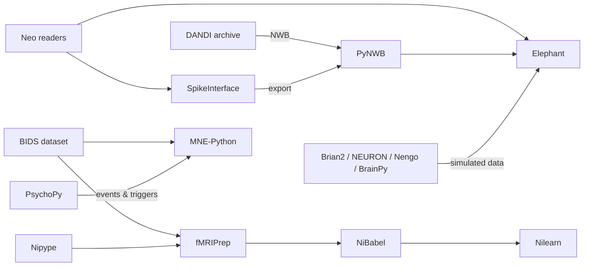

# Py10 Python Neuroscience Packages

> [[Py00 Python Overview|↑ Python]] · [[MOC-programming|Programming MOC]] · [[Py10 Python Neuroscience Packages - Worksheet|✏️ Worksheet]] · [[Py10 Python Neuroscience Packages - Solutions|✅ Solutions]] · [[Mistakes - Python|⚠️ Mistake log]]

## Why this matters
You don't write an EEG pipeline or a spike sorter from scratch: there are mature, open-source, community-tested packages for every data type. Knowing **which package does what** and **which data structure it uses** lets you read methods sections, reuse pipelines and avoid reinventing (buggy) wheels. All of them build on NumPy, SciPy and matplotlib ([[Py05 NumPy and Arrays]], [[Py08 SciPy Scientific Computing]]).

## The landscape
| Package | What it does | Where to find it | Install |
|---|---|---|---|
| **MNE-Python** | EEG/MEG/iEEG: reading formats, filtering, ICA, epochs, ERPs, time–frequency, source reconstruction, decoding | mne.tools | `pip install mne` |
| **NiBabel** | read/write neuroimaging files (NIfTI, MGH/FreeSurfer, GIFTI, CIFTI) | nipy.org/nibabel | `pip install nibabel` |
| **Nilearn** | statistics, machine learning and plotting for fMRI (maskers, GLM, connectivity, decoding, brain plots) | nilearn.github.io | `pip install nilearn` |
| **fMRIPrep** | standardised, robust fMRI preprocessing (BIDS in → preprocessed data + QC report out) | fmriprep.org | container: Docker / Apptainer (Singularity) |
| **PyNWB** | read/write Neurodata Without Borders files | pynwb.readthedocs.io | `pip install pynwb` |
| **SpikeInterface** | unified interface to spike sorters (Kilosort, MountainSort, …), preprocessing, quality metrics, comparison | spikeinterface.readthedocs.io | `pip install spikeinterface` |
| **Neo** | common data model + readers for electrophysiology formats (Blackrock, Plexon, Intan, Axon, …) | neuralensemble.org/neo | `pip install neo` |
| **Elephant** | analysis of spike trains and LFPs (rates, ISI statistics, correlations, spike–field coherence) on Neo objects | elephant.readthedocs.io | `pip install elephant` |
| **Brian2** | simulator for spiking neural networks; models written as equations | briansimulator.org | `pip install brian2` |
| **NEURON** (Python interface) | detailed, morphologically realistic (multi-compartment) neuron simulation | neuron.yale.edu | `pip install neuron` |
| **Nengo** | large-scale functional brain models (Neural Engineering Framework), cognition | nengo.ai | `pip install nengo` |
| **BrainPy** | simulation **and** training of brain dynamics models (JAX-based, GPU) | brainpy.readthedocs.io | `pip install brainpy` |
| **PsychoPy** | experiment control and stimulus presentation | psychopy.org | standalone installer recommended; `pip install psychopy` |
| **Pyglet** | windows, OpenGL graphics, input; one of the backends of PsychoPy | pyglet.org | `pip install pyglet` |
| **DANDI / dandi-cli** | search, download and upload open neurophysiology data (NWB) from the DANDI Archive | dandiarchive.org | `pip install dandi` |
| **Nipype** | workflows that combine tools (FSL, SPM, FreeSurfer, ANTs, AFNI) with provenance | nipype.readthedocs.io | `pip install nipype` |

## How they fit together


## Mini-examples
### MNE-Python: from raw EEG to an ERP
```python
import mne
raw = mne.io.read_raw_brainvision("sub-01_task-oddball_eeg.vhdr", preload=True)
raw.set_montage("standard_1020")
raw.filter(l_freq=0.1, h_freq=40)                     # zero-phase FIR by default
raw.set_eeg_reference("average")
events, event_id = mne.events_from_annotations(raw)
epochs = mne.Epochs(raw, events, event_id, tmin=-0.2, tmax=0.8,
                    baseline=(None, 0), reject=dict(eeg=150e-6), preload=True)
evoked = epochs["Stimulus/S  2"].average()
evoked.plot_joint()                                   # butterfly + topomaps
data = epochs.get_data()                              # NumPy: (trials, channels, times), in volts
```
- MNE stores EEG in **volts** (not µV) and times in seconds.
- Core objects: `Raw` (continuous), `Epochs` (trials), `Evoked` (averages), `Info` (metadata: channels, fs, montage).

### NiBabel and Nilearn: fMRI images
```python
import nibabel as nib
img = nib.load("sub-01_task-faces_bold.nii.gz")
img.shape            # (64, 64, 40, 300): x, y, z, time
img.affine           # 4×4 voxel → world (mm) transformation
img.header.get_zooms()   # voxel size (mm) and TR (s)
data = img.get_fdata()   # NumPy float64 array (loads everything!)

from nilearn import plotting, maskers
masker = maskers.NiftiMasker(mask_img="mask.nii.gz", standardize="zscore_sample", smoothing_fwhm=6)
X = masker.fit_transform(img)              # (time points, voxels): ready for scikit-learn
plotting.plot_stat_map("zmap.nii.gz", threshold=3.1, display_mode="ortho")
```
The **affine** maps voxel indices $(i, j, k)$ to scanner/MNI coordinates in mm: $\mathbf x_\text{mm} = A\,(i, j, k, 1)^T$ ([[C1 Matrices]], [[D1 Vectors in 2D and 3D]]).

### Spikes: SpikeInterface, Neo, Elephant
```python
import spikeinterface.full as si
rec = si.read_spikeglx("data/raw/session1")            # Neuropixels recording
rec_f = si.bandpass_filter(rec, freq_min=300, freq_max=6000)
sorting = si.run_sorter("kilosort4", rec_f, folder="sorting_ks4")   # needs the sorter installed

import neo, quantities as pq
from elephant.statistics import mean_firing_rate, isi, cv
st = neo.SpikeTrain([0.10, 0.25, 0.31, 0.90] * pq.s, t_stop=1.0 * pq.s)
mean_firing_rate(st)          # 4.0 Hz – with units!
cv(isi(st))                   # coefficient of variation of ISIs
```
Neo/Elephant use **quantities** (values with units), which prevents ms/s mix-ups.

### Brian2: a population of LIF neurons
```python
from brian2 import *
tau, EL, Vth, Vr = 10*ms, -65*mV, -50*mV, -65*mV
eqs = "dv/dt = (EL - v + I)/tau : volt (unless refractory)\nI : volt"
G = NeuronGroup(100, eqs, threshold="v > Vth", reset="v = Vr", refractory=2*ms, method="exact")
G.v = EL; G.I = "20*mV * rand()"
M = SpikeMonitor(G)
run(500*ms)
```
You write the **differential equation**; Brian2 generates and compiles the code ([[B10 Differential Equations]], [[CS10 Dynamical and Computational Neuro Models]]).

### DANDI: open data
```bash
dandi download DANDI:000006/draft      # a whole dandiset of NWB files
```
Or stream single files with `DandiAPIClient` + `remfile`/`fsspec` without downloading.

## Choosing a simulator
| Question | Tool |
|---|---|
| networks of point neurons, flexible equations | Brian2 (or NEST for very large networks) |
| dendrites, morphology, ion channels | NEURON |
| cognitive function from neural populations | Nengo |
| trainable dynamical models on GPU | BrainPy (or PyTorch) |

## In neuroscience #neuro
- **A typical EEG paper pipeline:** PsychoPy (triggers) → BrainVision/EDF files in BIDS → MNE (filter, ICA, epochs) → statistics (cluster permutation tests in MNE, or mixed models in R).
- **A typical fMRI pipeline:** BIDS → fMRIPrep (container) → Nilearn first-level and second-level GLMs / decoding ([[CS12 Neuroimaging Data Analysis]]).
- **A typical Neuropixels pipeline:** SpikeGLX → SpikeInterface (preprocess, Kilosort, quality metrics, curation) → NWB → DANDI ([[Meth03 Electrophysiology]]).
- **Computational models:** Brian2/NEURON simulations analysed with Elephant using the same functions as real data.

## Math links #math-link
- Affine transformations (voxel → mm) → [[C1 Matrices]], [[D3 Lines and Planes]]
- ODEs in simulators → [[B10 Differential Equations]]
- Spectral and time–frequency analysis in MNE → [[B12 Fourier Analysis]]
- ICA, PCA (artefact removal) → [[C4 Eigenvalues and Eigenvectors]]

## Connections
- File formats (NWB, NIfTI, BIDS) → [[Py04 Python Files and Data Formats]], [[CS05 Data Formats and Representation]]
- Analysis concepts → [[CS11 Time Series and Signal Processing]], [[CS12 Neuroimaging Data Analysis]], [[CS10 Dynamical and Computational Neuro Models]]
- Methods producing the data → [[Meth03 Electrophysiology]], [[Meth04 In Vivo Imaging]]
- Experiments → [[Py11 PsychoPy Experiment Control]]
- Equivalents: R → [[R09 R Neuroscience Packages]]; MATLAB → [[MAT10 MATLAB Neuroscience Toolboxes]], [[MAT09 EEGLAB]]

## Key takeaways
- EEG/MEG → MNE; MRI files → NiBabel; fMRI analysis/plots → Nilearn; preprocessing → fMRIPrep (container).
- Spikes → SpikeInterface (sorting), Neo (reading), Elephant (analysis); sharing → PyNWB + DANDI.
- Simulation → Brian2 (networks), NEURON (morphology), Nengo (cognition), BrainPy (trainable).
- Check units: MNE uses volts; Neo/Elephant/Brian2 carry explicit units.
