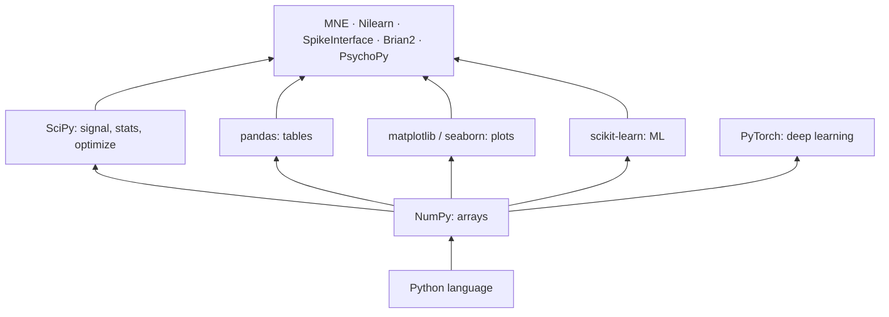
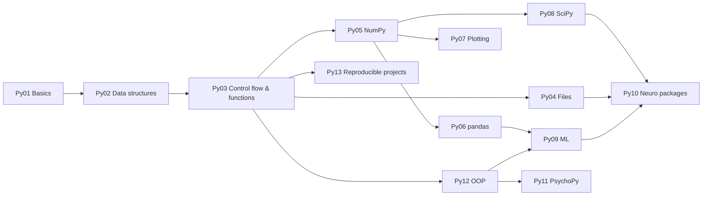

# Py00 Python Overview – Python for Neuroscience

> [[MOC-programming|↑ Programming MOC]] · ⚠️ [[Mistakes - Python]] · Shared concepts: [[Prog00 Shared Programming Concepts]]

## What Python is – and why it dominates neuroscience
Python is a free, general-purpose, interpreted language with a very readable syntax. On its own it's slow for numbers; its power comes from the **scientific stack**, compiled libraries that do the heavy lifting:

| Strengths | Weaknesses |
|---|---|
| free and open source; runs everywhere (laptop, cluster, cloud) | 0-based indexing and indentation surprise R/MATLAB users |
| the deep-learning and most neuro-analysis ecosystems are Python | statistics with mixed models is less mature than in R |
| general-purpose: experiments, analysis, web, automation in one language | package/environment management needs care ([[Py13 Python Reproducible Projects and Testing]]) |
| huge community, excellent documentation | pure-Python loops are slow → vectorise ([[Py05 NumPy and Arrays]]) |

## Topics
| # | Topic | Key idea | Practice |
|---|---|---|---|
| Py01 | [[Py01 Python Basics and Syntax]] | interpreter, scripts, notebooks; indentation; numbers, strings, f-strings | [[Py01 Python Basics and Syntax - Worksheet\|✏️]] · [[Py01 Python Basics and Syntax - Solutions\|✅]] |
| Py02 | [[Py02 Python Data Structures]] | list, tuple, dict, set; comprehensions; mutability | [[Py02 Python Data Structures - Worksheet\|✏️]] · [[Py02 Python Data Structures - Solutions\|✅]] |
| Py03 | [[Py03 Python Control Flow and Functions]] | if/for/while; defaults, `*args`, `**kwargs`; lambda; generators | [[Py03 Python Control Flow and Functions - Worksheet\|✏️]] · [[Py03 Python Control Flow and Functions - Solutions\|✅]] |
| Py04 | [[Py04 Python Files and Data Formats]] | `with open`; CSV, JSON, pickle (unsafe), HDF5, Zarr, NWB | [[Py04 Python Files and Data Formats - Worksheet\|✏️]] · [[Py04 Python Files and Data Formats - Solutions\|✅]] |
| Py05 | [[Py05 NumPy and Arrays]] | shape, dtype, broadcasting, masks, axis, linalg, seeds | [[Py05 NumPy and Arrays - Worksheet\|✏️]] · [[Py05 NumPy and Arrays - Solutions\|✅]] |
| Py06 | [[Py06 pandas and Tabular Data]] | DataFrame, groupby, merge, pivot, NaN, time series | [[Py06 pandas and Tabular Data - Worksheet\|✏️]] · [[Py06 pandas and Tabular Data - Solutions\|✅]] |
| Py07 | [[Py07 Python Plotting and Visualization]] | Figure/Axes, subplots, seaborn, colour maps | [[Py07 Python Plotting and Visualization - Worksheet\|✏️]] · [[Py07 Python Plotting and Visualization - Solutions\|✅]] |
| Py08 | [[Py08 SciPy Scientific Computing]] | filters, spectra, peaks; tests; fitting; ODEs; interpolation | [[Py08 SciPy Scientific Computing - Worksheet\|✏️]] · [[Py08 SciPy Scientific Computing - Solutions\|✅]] |
| Py09 | [[Py09 Python Machine Learning Libraries]] | sklearn pipelines and CV; PyTorch tensors, autograd, training loop | [[Py09 Python Machine Learning Libraries - Worksheet\|✏️]] · [[Py09 Python Machine Learning Libraries - Solutions\|✅]] |
| Py10 | [[Py10 Python Neuroscience Packages]] | MNE, NiBabel, Nilearn, fMRIPrep, SpikeInterface, Brian2, NWB, DANDI … | [[Py10 Python Neuroscience Packages - Worksheet\|✏️]] · [[Py10 Python Neuroscience Packages - Solutions\|✅]] |
| Py11 | [[Py11 PsychoPy Experiment Control]] | Builder vs. Coder, flips and frames, responses, conditions, triggers | [[Py11 PsychoPy Experiment Control - Worksheet\|✏️]] · [[Py11 PsychoPy Experiment Control - Solutions\|✅]] |
| Py12 | [[Py12 Python Object-Oriented Programming]] | classes, objects, methods, inheritance; when OOP helps | [[Py12 Python Object-Oriented Programming - Worksheet\|✏️]] · [[Py12 Python Object-Oriented Programming - Solutions\|✅]] |
| Py13 | [[Py13 Python Reproducible Projects and Testing]] | project layout, environments, pytest, logging, docstrings | [[Py13 Python Reproducible Projects and Testing - Worksheet\|✏️]] · [[Py13 Python Reproducible Projects and Testing - Solutions\|✅]] |

**Order:** Py01 → Py05 first (programming stage P2), then Py06–Py10 when you start analysing data (P6), Py11 for experiments (P7), Py12–Py13 with your first own project (P8). See [[MOC-programming]] for the full path.

## Setting up (short)
- Install a distribution that manages environments: **Miniforge** (conda/mamba with conda-forge) or **uv**; create one environment per project ([[Py13 Python Reproducible Projects and Testing]]).
- Editor: **VS Code** with the Python and Jupyter extensions (also used for LaTeX, [[Doc09 LaTeX with VS Code]]) or JupyterLab.
- PsychoPy: use the standalone installer for experiments ([[Py11 PsychoPy Experiment Control]]).

## Python vs. R vs. MATLAB at a glance
| | Python | R | MATLAB |
|---|---|---|---|
| indexing | 0-based, `[start:stop)` | 1-based, inclusive | 1-based, inclusive |
| core data type | ndarray / DataFrame | vector / data frame | matrix |
| strengths | ML, deep learning, MNE, PsychoPy, general purpose | statistics, mixed models, ggplot2, reports | matrices, toolboxes (EEGLAB, FieldTrip, SPM), Psychtoolbox |
| cost | free | free | licence |
→ [[R00 R Overview]] · [[MAT00 MATLAB Overview]]

## Where Python meets the rest of the vault
| Python topic | Concept notes |
|---|---|
| NumPy linear algebra, SVD, PCA | [[C1 Matrices]], [[C4 Eigenvalues and Eigenvectors]], [[CS01 Mathematical Foundations]] |
| SciPy filters and spectra | [[B12 Fourier Analysis]], [[CS11 Time Series and Signal Processing]], [[Ph09 Waves and Oscillations]] |
| ODE solvers, Brian2, OOP neurons | [[B10 Differential Equations]], [[CS10 Dynamical and Computational Neuro Models]], [[Ph05 Capacitance and RC Circuits]] |
| scipy.stats, permutation tests | [[CS02 Probability and Statistics]] |
| scikit-learn, PyTorch | [[CS07 Machine Learning Fundamentals]], [[CS08 Deep Neural Networks]], [[CS04 Optimization]], [[B11 Multivariable Calculus]] |
| Files, NWB, BIDS | [[CS05 Data Formats and Representation]] |
| MNE, Nilearn, SpikeInterface | [[Meth03 Electrophysiology]], [[Meth04 In Vivo Imaging]], [[CS12 Neuroimaging Data Analysis]] |
| Projects and tests | [[CS13 Reproducibility and Research Software]] |

## Progress
- [ ] Py01 Python Basics and Syntax
- [ ] Py02 Python Data Structures
- [ ] Py03 Python Control Flow and Functions
- [ ] Py04 Python Files and Data Formats
- [ ] Py05 NumPy and Arrays
- [ ] Py06 pandas and Tabular Data
- [ ] Py07 Python Plotting and Visualization
- [ ] Py08 SciPy Scientific Computing
- [ ] Py09 Python Machine Learning Libraries
- [ ] Py10 Python Neuroscience Packages
- [ ] Py11 PsychoPy Experiment Control
- [ ] Py12 Python Object-Oriented Programming
- [ ] Py13 Python Reproducible Projects and Testing
