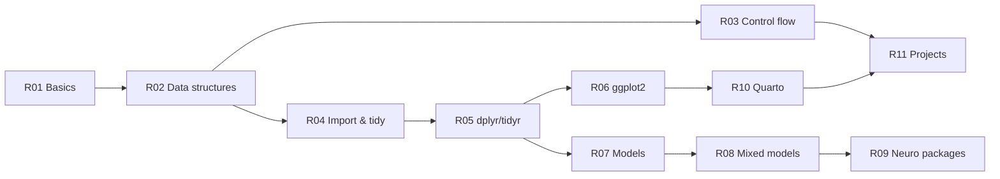

# R00 R Overview – R for Neuroscience

> [[MOC-programming|↑ Programming MOC]] · ⚠️ [[Mistakes - R]] · Shared concepts: [[Prog00 Shared Programming Concepts]]

## What R is – and what it's best at
R is a free language and environment for **statistics and graphics**, developed from S at Bell Labs and maintained by the R Core Team. Its unique strength is the depth of its statistical packages (more than 20,000 on CRAN): mixed models, Bayesian regression, psychometrics, survival analysis – often written by the statisticians who developed the methods. With the **tidyverse** and **Quarto**, R also covers data wrangling, publication figures and reproducible reports.

| Strengths | Weaknesses |
|---|---|
| statistics: lme4, brms, emmeans, afex, BayesFactor | signal/image processing ecosystem is small (→ Python/MATLAB) |
| ggplot2 for publication figures | 1-based indexing, recycling and NA rules surprise newcomers |
| tidy data workflow (dplyr, tidyr) | several OOP systems and coding styles (base vs. tidyverse) |
| reproducible reports (Quarto), renv | large raw recordings don't fit R's in-memory model well |
| free; strong in psychology, ecology, biostatistics | slower for loops (vectorise!) |

**Typical role in neuroscience:** the last part of the pipeline – statistics and figures on trial- or subject-level measures exported from Python/MATLAB, plus behavioural experiments' analyses.

## Topics
| # | Topic | Key idea | Practice |
|---|---|---|---|
| R01 | [[R01 R Basics and Syntax]] | RStudio, `<-`, `?`, types, factors | [[R01 R Basics and Syntax - Worksheet\|✏️]] · [[R01 R Basics and Syntax - Solutions\|✅]] |
| R02 | [[R02 R Data Structures and Vectorization]] | vectors, lists, matrices, data frames; recycling; apply/map | [[R02 R Data Structures and Vectorization - Worksheet\|✏️]] · [[R02 R Data Structures and Vectorization - Solutions\|✅]] |
| R03 | [[R03 R Control Flow and Functions]] | if/for/while, functions, `...`, NA | [[R03 R Control Flow and Functions - Worksheet\|✏️]] · [[R03 R Control Flow and Functions - Solutions\|✅]] |
| R04 | [[R04 R Data Import and Tidy Data]] | CSV, Excel, RDS, Parquet; tidy principle; pipes | [[R04 R Data Import and Tidy Data - Worksheet\|✏️]] · [[R04 R Data Import and Tidy Data - Solutions\|✅]] |
| R05 | [[R05 dplyr and tidyr]] | filter/select/mutate/summarise/group_by; pivots; joins | [[R05 dplyr and tidyr - Worksheet\|✏️]] · [[R05 dplyr and tidyr - Solutions\|✅]] |
| R06 | [[R06 ggplot2 Visualization]] | data + aes + geoms + facets; themes; ggsave | [[R06 ggplot2 Visualization - Worksheet\|✏️]] · [[R06 ggplot2 Visualization - Solutions\|✅]] |
| R07 | [[R07 R Statistical Modelling]] | lm, glm, residuals, ANOVA, t-tests, non-parametric | [[R07 R Statistical Modelling - Worksheet\|✏️]] · [[R07 R Statistical Modelling - Solutions\|✅]] |
| R08 | [[R08 R Mixed-Effects Models]] | lme4/lmerTest, random intercepts & slopes, model comparison, brms | [[R08 R Mixed-Effects Models - Worksheet\|✏️]] · [[R08 R Mixed-Effects Models - Solutions\|✅]] |
| R09 | [[R09 R Neuroscience Packages]] | eegUtils, signal, oro.nifti, BayesFactor, reticulate, rhdf5 … | [[R09 R Neuroscience Packages - Worksheet\|✏️]] · [[R09 R Neuroscience Packages - Solutions\|✅]] |
| R10 | [[R10 R Markdown and Quarto]] | chunks, inline code, HTML/PDF, formulas, citations | [[R10 R Markdown and Quarto - Worksheet\|✏️]] · [[R10 R Markdown and Quarto - Solutions\|✅]] |
| R11 | [[R11 R Reproducible Projects]] | RStudio Projects + here, renv, testthat | [[R11 R Reproducible Projects - Worksheet\|✏️]] · [[R11 R Reproducible Projects - Solutions\|✅]] |

**Order:** R01–R06 as one block (programming stage P4), R07–R08 when you analyse experiments (P6, after [[CS02 Probability and Statistics]]), R09 as needed, R10–R11 with your first report/project (P8). See [[MOC-programming]].

## Setting up (short)
- Install **R** from CRAN, then **RStudio Desktop** (or VS Code + R extension / Positron).
- In RStudio: *Tools → Global Options → General*: untick "Restore .RData", set "Save workspace" to **Never**; *Code*: use native pipe `|>`.
- Start every analysis as an **RStudio Project** with renv ([[R11 R Reproducible Projects]]).
- For brms/rstan you need a C++ toolchain (Rtools on Windows, Xcode command line tools on macOS).

## Base R vs. tidyverse
Both are R; you'll meet both in papers and lab code.
| Task | base R | tidyverse |
|---|---|---|
| subset rows | `d[d$rt > 0.2, ]`, `subset()` | `filter(d, rt > 0.2)` |
| new column | `d$ms <- d$rt * 1000` | `mutate(d, ms = rt * 1000)` |
| group means | `aggregate(rt ~ cond, d, mean)`, `tapply()` | `d \|> summarise(m = mean(rt), .by = cond)` |
| read CSV | `read.csv()` | `readr::read_csv()` |
| plot | `plot()`, `hist()` | `ggplot()` |
| loop over list | `lapply()` | `purrr::map()` |

## Where R meets the rest of the vault
| R topic | Concept notes |
|---|---|
| models, tests, power | [[CS02 Probability and Statistics]], [[CS06 Data Science Workflow]] |
| GLMs (Poisson spike counts, logistic psychometrics) | [[CS09 Probabilistic and Bayesian Models]], [[B2 Exponential Functions]], [[A3 Logarithms]] |
| Bayesian models | [[CS09 Probabilistic and Bayesian Models]] |
| least squares and design matrices | [[C1 Matrices]], [[C3 Linear Systems and Gaussian Elimination]] |
| tidy data | [[CS05 Data Formats and Representation]] |
| reports and reproducibility | [[CS13 Reproducibility and Research Software]], [[Doc02 Math in Markdown]] |
| Python/MATLAB counterparts | [[Py00 Python Overview]], [[MAT00 MATLAB Overview]] |

## Progress
- [ ] R01 R Basics and Syntax
- [ ] R02 R Data Structures and Vectorization
- [ ] R03 R Control Flow and Functions
- [ ] R04 R Data Import and Tidy Data
- [ ] R05 dplyr and tidyr
- [ ] R06 ggplot2 Visualization
- [ ] R07 R Statistical Modelling
- [ ] R08 R Mixed-Effects Models
- [ ] R09 R Neuroscience Packages
- [ ] R10 R Markdown and Quarto
- [ ] R11 R Reproducible Projects
