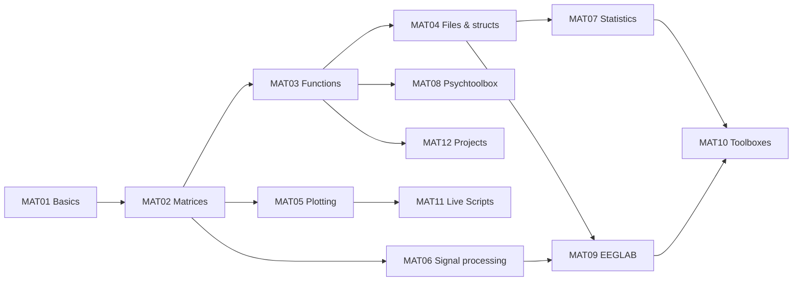

# MAT00 MATLAB Overview – MATLAB for Neuroscience

> [[MOC-programming|↑ Programming MOC]] · ⚠️ [[Mistakes - MATLAB]] · Shared concepts: [[Prog00 Shared Programming Concepts]]

## What MATLAB is – and why neuroscience still uses it
MATLAB (MathWorks) is a commercial numerical computing environment built around **matrices**. It came to neuroscience early (1990s) and became the home of the field's classic toolboxes: **EEGLAB**, **FieldTrip**, **SPM**, **Brainstorm**, **Psychtoolbox**, **Chronux**. Many labs' legacy code, course materials and published pipelines are MATLAB.

| Strengths | Weaknesses |
|---|---|
| matrix syntax close to linear algebra | **licence costs** (MATLAB + toolboxes); code depends on what your institute licenses |
| mature neuro toolboxes (EEGLAB, FieldTrip, SPM, Psychtoolbox) | no standard package/environment manager for third-party toolboxes |
| excellent documentation, integrated IDE, debugger, profiler | `*` vs `.*`, 1-based indexing, path shadowing |
| fast vectorised maths and plotting | deep learning and many new methods appear first in Python |
| Simulink, hardware interfaces, Live Scripts | `.mlx`/`.mat` are less open formats |
GNU **Octave** is a free, largely compatible alternative (runs Psychtoolbox and many scripts, but not all toolboxes or newer syntax).

## Topics
| # | Topic | Key idea | Practice |
|---|---|---|---|
| MAT01 | [[MAT01 MATLAB Basics and Syntax]] | Command Window, Editor, Live Scripts; `;`, `help`/`doc`; types; char vs. string | [[MAT01 MATLAB Basics and Syntax - Worksheet\|✏️]] · [[MAT01 MATLAB Basics and Syntax - Solutions\|✅]] |
| MAT02 | [[MAT02 MATLAB Matrices and Vectorization]] | matrices, 1-based indexing, `.*` vs. `*`, logical indexing, `find`, `end` | [[MAT02 MATLAB Matrices and Vectorization - Worksheet\|✏️]] · [[MAT02 MATLAB Matrices and Vectorization - Solutions\|✅]] |
| MAT03 | [[MAT03 MATLAB Control Flow and Functions]] | for/while/if/switch; function files, local and anonymous functions; `varargin`, `nargin` | [[MAT03 MATLAB Control Flow and Functions - Worksheet\|✏️]] · [[MAT03 MATLAB Control Flow and Functions - Solutions\|✅]] |
| MAT04 | [[MAT04 MATLAB Data Import and Files]] | `readtable`, `readmatrix`, `load`/`save`; structs and cells; `dir`, `fullfile` | [[MAT04 MATLAB Data Import and Files - Worksheet\|✏️]] · [[MAT04 MATLAB Data Import and Files - Solutions\|✅]] |
| MAT05 | [[MAT05 MATLAB Plotting]] | `plot`, `subplot`/`tiledlayout`, `histogram`, `imagesc`, `exportgraphics` | [[MAT05 MATLAB Plotting - Worksheet\|✏️]] · [[MAT05 MATLAB Plotting - Solutions\|✅]] |
| MAT06 | [[MAT06 MATLAB Signal Processing Toolbox]] | `fft`, `butter`, `filtfilt`, `pwelch`, `spectrogram`, `findpeaks` | [[MAT06 MATLAB Signal Processing Toolbox - Worksheet\|✏️]] · [[MAT06 MATLAB Signal Processing Toolbox - Solutions\|✅]] |
| MAT07 | [[MAT07 MATLAB Statistics Toolbox]] | `fitlm`, `fitglm`, `fitlme`; `ttest`, `anova`, `signrank`; permutation tests | [[MAT07 MATLAB Statistics Toolbox - Worksheet\|✏️]] · [[MAT07 MATLAB Statistics Toolbox - Solutions\|✅]] |
| MAT08 | [[MAT08 Psychtoolbox]] | `Screen('Flip')`, textures, `KbCheck`, frame timing, triggers, sync tests | [[MAT08 Psychtoolbox - Worksheet\|✏️]] · [[MAT08 Psychtoolbox - Solutions\|✅]] |
| MAT09 | [[MAT09 EEGLAB]] | GUI vs. scripting, import, filter, re-reference, ICA, epochs, ERPs, plug-ins | [[MAT09 EEGLAB - Worksheet\|✏️]] · [[MAT09 EEGLAB - Solutions\|✅]] |
| MAT10 | [[MAT10 MATLAB Neuroscience Toolboxes]] | FieldTrip, SPM, CONN, Brainstorm, ERPLAB, Chronux …; licences | [[MAT10 MATLAB Neuroscience Toolboxes - Worksheet\|✏️]] · [[MAT10 MATLAB Neuroscience Toolboxes - Solutions\|✅]] |
| MAT11 | [[MAT11 MATLAB Live Scripts and Reports]] | `.mlx`, `publish`, LaTeX equations | [[MAT11 MATLAB Live Scripts and Reports - Worksheet\|✏️]] · [[MAT11 MATLAB Live Scripts and Reports - Solutions\|✅]] |
| MAT12 | [[MAT12 MATLAB Reproducible Projects]] | project folders, path management, `matlab.unittest`, Git | [[MAT12 MATLAB Reproducible Projects - Worksheet\|✏️]] · [[MAT12 MATLAB Reproducible Projects - Solutions\|✅]] |

**Order:** MAT01–MAT03 (programming stage P5), MAT04–MAT09 for applications (P6) – MAT06 after [[B12 Fourier Analysis]], MAT07 after [[CS02 Probability and Statistics]] –, MAT08 with experiments (P7), MAT10–MAT12 when you start a project (P8). See [[MOC-programming]].

## Setting up (short)
- Install MATLAB via your university licence; add the **Signal Processing** and **Statistics and Machine Learning** toolboxes (needed by many neuro toolboxes; check with `ver`).
- Download third-party toolboxes into a project-specific `toolboxes/` folder and add them **in code** ([[MAT12 MATLAB Reproducible Projects]]); avoid `savepath`.
- Editor settings: show code analyser warnings (orange underlines often mark real bugs, e.g. growing arrays, unused variables).

## Where MATLAB meets the rest of the vault
| MATLAB topic | Concept notes |
|---|---|
| matrices, `A\b`, `eig`, `svd` | [[C1 Matrices]], [[C3 Linear Systems and Gaussian Elimination]], [[C4 Eigenvalues and Eigenvectors]] |
| `fft`, filters, spectra | [[B12 Fourier Analysis]], [[CS11 Time Series and Signal Processing]], [[Ph09 Waves and Oscillations]] |
| `ode45`, LIF loops | [[B10 Differential Equations]], [[CS10 Dynamical and Computational Neuro Models]] |
| statistics, permutation tests | [[CS02 Probability and Statistics]] |
| EEGLAB, FieldTrip, SPM | [[Meth03 Electrophysiology]], [[Meth04 In Vivo Imaging]], [[CS12 Neuroimaging Data Analysis]] |
| Psychtoolbox | [[Py11 PsychoPy Experiment Control]] (same concepts) |
| projects, tests, Git | [[CS13 Reproducibility and Research Software]] |
| Python/R counterparts | [[Py00 Python Overview]], [[R00 R Overview]] |

## Progress
- [ ] MAT01 MATLAB Basics and Syntax
- [ ] MAT02 MATLAB Matrices and Vectorization
- [ ] MAT03 MATLAB Control Flow and Functions
- [ ] MAT04 MATLAB Data Import and Files
- [ ] MAT05 MATLAB Plotting
- [ ] MAT06 MATLAB Signal Processing Toolbox
- [ ] MAT07 MATLAB Statistics Toolbox
- [ ] MAT08 Psychtoolbox
- [ ] MAT09 EEGLAB
- [ ] MAT10 MATLAB Neuroscience Toolboxes
- [ ] MAT11 MATLAB Live Scripts and Reports
- [ ] MAT12 MATLAB Reproducible Projects
