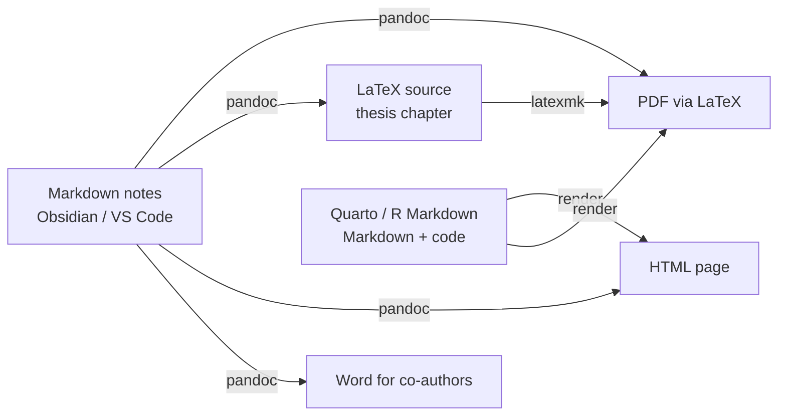

# Doc10 When to Use What

> [[Doc00 Markdown HTML and LaTeX Overview|↑ Markdown, HTML & LaTeX]] · [[MOC-programming|Programming MOC]] · [[Doc10 When to Use What - Worksheet|✏️ Worksheet]] · [[Doc10 When to Use What - Solutions|✅ Solutions]] · [[Mistakes - Markdown HTML LaTeX|⚠️ Mistake log]]

## Why this matters
Markdown, HTML and LaTeX overlap: all three can hold headings, lists, formulas and figures. Choosing the right one for each job – and knowing how to convert between them – saves hours of reformatting. The rule of thumb: **write in Markdown, export when needed**.

## The three formats at a glance
| | Markdown | HTML | LaTeX |
|---|---|---|---|
| what it is | lightweight plain-text markup | the language of web pages | a typesetting system for print/PDF |
| strengths | fast to write and read, future-proof, diff-friendly, links (Obsidian) | layout, interactivity, any screen, embedded media | precise maths, typography, automatic numbering, cross-refs, bibliographies, journal templates |
| weaknesses | limited layout; flavours differ | verbose to write by hand; print layout is weak | steep learning curve, compile step, cryptic errors |
| output | rendered view, or anything via Pandoc | browser | PDF |
| typical tools | Obsidian, GitHub, Jupyter, Quarto | browsers, Quarto/R Markdown, MNE Report, websites | TeX Live, Overleaf, VS Code + LaTeX Workshop |

## Markdown – for notes and knowledge networks
- **Obsidian vaults** like this one: linked notes, quick capture, lecture notes, reading notes, mistake logs ([[Doc01 Markdown Syntax]]).
- READMEs, lab wikis, protocols, preregistration drafts, meeting notes.
- Text cells in notebooks and the source of Quarto/R Markdown reports ([[R10 R Markdown and Quarto]]).
- Formulas in LaTeX syntax already work ([[Doc02 Math in Markdown]]).

## HTML – for layout, interactive reports and the web
- **Analysis reports** with figures, folded code and interactive plots (Quarto/R Markdown/Jupyter HTML, MNE `Report`, fMRIPrep QC) ([[Doc04 HTML for Reports and Figures]]).
- Lab and project websites, online supplementary material, documentation sites (Sphinx, MkDocs, Quarto websites).
- Online experiments (PsychoJS, jsPsych).
- You rarely write full HTML by hand – you **generate** it from Markdown and touch up with a little HTML/CSS ([[Doc03 HTML Basics]]).

## LaTeX – for formal documents with precise mathematics
- **Theses, papers, scripts and lecture notes** with many equations, figure/table numbering, cross-references and a bibliography ([[Doc05 LaTeX Basics]], [[Doc06 LaTeX Math]], [[Doc07 LaTeX Documents and TeX Live]], [[Doc08 LaTeX Figures Tables and References]]).
- Journal templates and submission (many physics/computational journals expect LaTeX).
- Beamer slides with the same maths as the paper.
- Also when a Word document would become unmanageable (200 pages, 80 figures, 300 references).

## Rule of thumb: write in Markdown, export via Pandoc to LaTeX or PDF when needed

- **Pandoc** is the bridge: `pandoc notes.md -o notes.pdf`, `pandoc notes.md -s -o notes.tex`, `--citeproc --bibliography refs.bib` ([[Doc09 LaTeX with VS Code]]).
- **Quarto** = Markdown + executed code → HTML/PDF/Word/slides from one source.
- Keep notes **portable** if you plan to export them: standard Markdown links next to wikilinks, `$…$` math, `[@key]` citations.

## Decision guide
| Situation | Use |
|---|---|
| lecture notes, reading notes, this vault | Markdown (Obsidian) |
| quick analysis report for your supervisor | Quarto/R Markdown/Jupyter → HTML |
| per-subject QC pages | HTML (MNE Report, Quarto, `publish`) |
| lab protocol / dataset README | Markdown |
| poster | LaTeX (beamerposter, tikzposter) or a design tool; PowerPoint is common too |
| conference talk with equations | LaTeX beamer, or Quarto revealjs (HTML slides) |
| journal article | the journal's template: LaTeX or Word – Quarto can produce both |
| bachelor/master/PhD thesis | LaTeX (or Quarto book → PDF via LaTeX) |
| co-authors only use Word | write in Markdown/Quarto → `docx`, or Word directly |
| interactive figure for a website | HTML (Plotly, Bokeh) |

## In neuroscience #neuro
- **Notes → paper pipeline:** reading notes and methods drafts in Obsidian → Pandoc/Quarto → LaTeX thesis chapters with the same equations and citations.
- **Reproducible results:** Quarto reports (HTML for the lab, PDF for the thesis appendix) computed directly from the data ([[CS13 Reproducibility and Research Software]]).
- **Open science:** HTML supplements and project websites; preregistrations as PDF from Markdown.

## Connections
- All Doc topics: [[Doc01 Markdown Syntax]] · [[Doc02 Math in Markdown]] · [[Doc03 HTML Basics]] · [[Doc04 HTML for Reports and Figures]] · [[Doc05 LaTeX Basics]] · [[Doc06 LaTeX Math]] · [[Doc07 LaTeX Documents and TeX Live]] · [[Doc08 LaTeX Figures Tables and References]] · [[Doc09 LaTeX with VS Code]]
- Reports from code → [[R10 R Markdown and Quarto]], [[MAT11 MATLAB Live Scripts and Reports]]

## Key takeaways
- Markdown for notes and knowledge networks; HTML for layout, interactive reports and the web; LaTeX for formal documents with precise maths.
- Write in Markdown, convert with Pandoc (or render with Quarto) to LaTeX, PDF, HTML or Word.
- Keep exported notes portable (standard links, `$…$` math, `[@citations]`).
