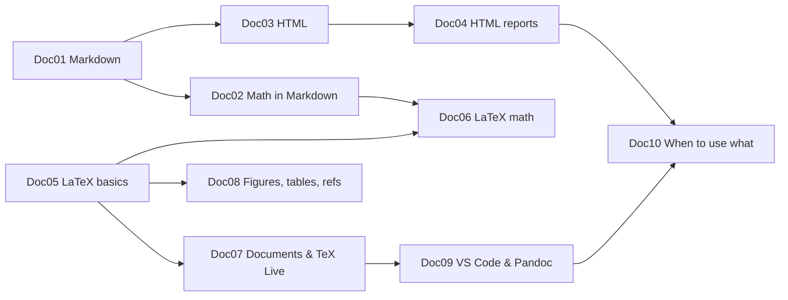

# Doc00 Markdown, HTML and LaTeX – Overview

> [[MOC-programming|↑ Programming MOC]] · ⚠️ [[Mistakes - Markdown HTML LaTeX]]

## What this part is about
Programming in science isn't only analysis code – it's also **writing**: notes, READMEs, reports, papers, a thesis. Three markup languages cover almost everything:
- **Markdown** – lightweight text formatting; the language of this vault, Jupyter text cells, GitHub and Quarto.
- **HTML** (+ a little CSS) – the language of web pages and of interactive analysis reports.
- **LaTeX** – the typesetting system for documents with precise mathematics, numbering and bibliographies.
They share one thing: **LaTeX math syntax** works in all three ([[Doc02 Math in Markdown]], [[Doc06 LaTeX Math]]).

## Topics
| # | Topic | Key idea | Practice |
|---|---|---|---|
| Doc01 | [[Doc01 Markdown Syntax]] | headings, lists, links, code, tables, task lists, footnotes, quotes | [[Doc01 Markdown Syntax - Worksheet\|✏️]] · [[Doc01 Markdown Syntax - Solutions\|✅]] |
| Doc02 | [[Doc02 Math in Markdown]] | `$…$`, `$$…$$`, fractions, indices, matrices; Obsidian vs. GitHub vs. Quarto | [[Doc02 Math in Markdown - Worksheet\|✏️]] · [[Doc02 Math in Markdown - Solutions\|✅]] |
| Doc03 | [[Doc03 HTML Basics]] | document structure, core tags, attributes, classes/IDs, CSS idea | [[Doc03 HTML Basics - Worksheet\|✏️]] · [[Doc03 HTML Basics - Solutions\|✅]] |
| Doc04 | [[Doc04 HTML for Reports and Figures]] | `<figure>`, `
`, understanding Quarto/R Markdown/MATLAB HTML output | [[Doc04 HTML for Reports and Figures - Worksheet\|✏️]] · [[Doc04 HTML for Reports and Figures - Solutions\|✅]] |
| Doc05 | [[Doc05 LaTeX Basics]] | `\documentclass`, packages, commands/environments, sections, compiling, errors | [[Doc05 LaTeX Basics - Worksheet\|✏️]] · [[Doc05 LaTeX Basics - Solutions\|✅]] |
| Doc06 | [[Doc06 LaTeX Math]] | `equation`, `align`, matrices, operators, `\label`/`\eqref`, amsmath/mathtools | [[Doc06 LaTeX Math - Worksheet\|✏️]] · [[Doc06 LaTeX Math - Solutions\|✅]] |
| Doc07 | [[Doc07 LaTeX Documents and TeX Live]] | tlmgr, article/report/beamer, BibTeX/biblatex, geometry, fonts, TOC, headers | [[Doc07 LaTeX Documents and TeX Live - Worksheet\|✏️]] · [[Doc07 LaTeX Documents and TeX Live - Solutions\|✅]] |
| Doc08 | [[Doc08 LaTeX Figures Tables and References]] | graphicx, floats, booktabs, cleveref, vector graphics | [[Doc08 LaTeX Figures Tables and References - Worksheet\|✏️]] · [[Doc08 LaTeX Figures Tables and References - Solutions\|✅]] |
| Doc09 | [[Doc09 LaTeX with VS Code]] | LaTeX Workshop, SyncTeX, latexmk settings, Problems panel, Pandoc | [[Doc09 LaTeX with VS Code - Worksheet\|✏️]] · [[Doc09 LaTeX with VS Code - Solutions\|✅]] |
| Doc10 | [[Doc10 When to Use What]] | Markdown for notes, HTML for reports/web, LaTeX for formal documents; Pandoc | [[Doc10 When to Use What - Worksheet\|✏️]] · [[Doc10 When to Use What - Solutions\|✅]] |

**Order** (programming stage P3, in parallel with Python): Doc01 → Doc02 first (you use them in this vault every day), Doc03–Doc04 alongside your first HTML reports, then LaTeX Doc05 → Doc06, later Doc07 → Doc09; **Doc08 as soon as you make your first reports with figures**. Doc10 at the end as a summary. See [[MOC-programming]].

## Markdown ↔ HTML ↔ LaTeX at a glance
| Element | Markdown | HTML | LaTeX |
|---|---|---|---|
| heading | `## Methods` | `<h2>Methods</h2>` | `\section{Methods}` |
| bold / italic | `**b**` / `*i*` | `<strong>` / `<em>` | `\textbf{}` / `\emph{}` |
| list | `- item` | `<ul><li>item</li></ul>` | `\begin{itemize} \item …` |
| link | `[text](url)` | `<a href="url">text</a>` | `\href{url}{text}` (hyperref) |
| image | `` | `` | `\includegraphics{f}` |
| figure with caption | Quarto: `{#fig-x}` | `<figure>…<figcaption>` | `figure` + `\caption` + `\label` |
| table | pipe table | `<table>` | `tabular` + booktabs |
| inline math | `$x^2$` | MathJax `\(x^2\)` | `$x^2$` |
| display math | `$$…$$` | MathJax `\[…\]` | `\[…\]`, `equation`, `align` |
| comment | `<!-- -->` / `%% %%` (Obsidian) | `<!-- -->` | `%` |

## Where this part meets the rest of the vault
| Topic | Notes |
|---|---|
| reports from code | [[R10 R Markdown and Quarto]], [[MAT11 MATLAB Live Scripts and Reports]], [[Py01 Python Basics and Syntax]] (Jupyter) |
| figures to include | [[Py07 Python Plotting and Visualization]], [[R06 ggplot2 Visualization]], [[MAT05 MATLAB Plotting]] |
| READMEs, project docs | [[Py13 Python Reproducible Projects and Testing]], [[R11 R Reproducible Projects]], [[MAT12 MATLAB Reproducible Projects]], [[CS13 Reproducibility and Research Software]] |
| the maths you'll typeset | [[00 Roadmap]] (all math notes) |

## Progress
- [ ] Doc01 Markdown Syntax
- [ ] Doc02 Math in Markdown
- [ ] Doc03 HTML Basics
- [ ] Doc04 HTML for Reports and Figures
- [ ] Doc05 LaTeX Basics
- [ ] Doc06 LaTeX Math
- [ ] Doc07 LaTeX Documents and TeX Live
- [ ] Doc08 LaTeX Figures Tables and References
- [ ] Doc09 LaTeX with VS Code
- [ ] Doc10 When to Use What
