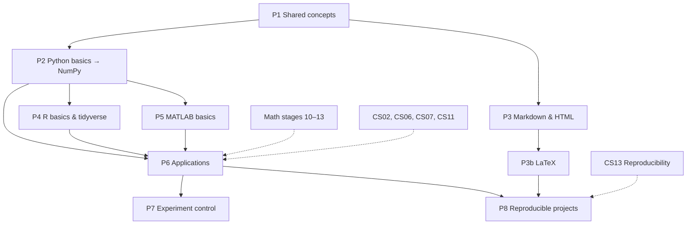

# MOC – Programming for Neuroscience

> [[MOC-neuroscience-foundations|↑ Neuroscience Foundations]] · Math: [[00 Roadmap]] · Concepts: [[MOC-computer-science]] · ⚠️ Mistake logs: [[Mistakes - Programming Basics]] · [[Mistakes - Python]] · [[Mistakes - R]] · [[Mistakes - MATLAB]] · [[Mistakes - Markdown HTML LaTeX]]

## What this field is about
This part reviews the **practical programming basics** you need for neuroscience – starting from school level. The computer-science part ([[MOC-computer-science]]) explains the *concepts* (statistics, ML, signal processing, data formats); this part is about *doing* them in the three languages of the field, plus the markup languages for writing:

| Block | Overview | What it's for | Mistake log |
|---|---|---|---|
| 00 · Shared concepts | [[Prog00 Shared Programming Concepts]] | variables, indexing, loops, functions, vectorisation, NaN/NA, seeds, paths – valid in every language | [[Mistakes - Programming Basics]] |
| 01 · Python | [[Py00 Python Overview]] | general purpose: data analysis, MNE/Nilearn/SpikeInterface, ML/deep learning, PsychoPy | [[Mistakes - Python]] |
| 02 · R | [[R00 R Overview]] | statistics: tidy data, ggplot2, (mixed) models, Bayesian models, reports | [[Mistakes - R]] |
| 03 · MATLAB | [[MAT00 MATLAB Overview]] | matrices, signal processing, EEGLAB/FieldTrip/SPM, Psychtoolbox | [[Mistakes - MATLAB]] |
| 04 · Markdown, HTML, LaTeX | [[Doc00 Markdown HTML and LaTeX Overview]] | notes, reports, papers, thesis | [[Mistakes - Markdown HTML LaTeX]] |

Every topic note has **rules with examples**, a "Same idea in …" comparison with the other languages, a `#neuro` section, `#math-link`s and connections. Worksheets are done **on paper** (predict outputs, find bugs, write snippets); only tasks marked 💻 need a computer.

## Learning path
Programming starts **early**, in parallel with the math and neuroscience stages – you'll use it to check calculations and to play with models long before you analyse real data.

| Stage | Notes | Why here |
|---|---|---|
| P1 · Shared concepts | [[Prog00 Shared Programming Concepts]] | the eight ideas behind every language; 0- vs. 1-based indexing |
| P2 · Python basics → NumPy | [[Py01 Python Basics and Syntax]] → [[Py02 Python Data Structures]] → [[Py03 Python Control Flow and Functions]] → [[Py04 Python Files and Data Formats]] → ⭐ [[Py05 NumPy and Arrays]] | one language properly first; NumPy = vectorised thinking |
| P3 · Markdown & HTML (in parallel) | [[Doc01 Markdown Syntax]] → [[Doc02 Math in Markdown]] → [[Doc03 HTML Basics]] → [[Doc04 HTML for Reports and Figures]] | you write in this vault every day; HTML reports come with the first analyses |
| P3b · LaTeX | [[Doc05 LaTeX Basics]] → [[Doc06 LaTeX Math]] → later [[Doc07 LaTeX Documents and TeX Live]] → [[Doc09 LaTeX with VS Code]]; [[Doc08 LaTeX Figures Tables and References]] as soon as you make reports with figures; [[Doc10 When to Use What]] as summary | after Markdown math; documents and tooling when you write longer texts |
| P4 · R basics & tidyverse | [[R01 R Basics and Syntax]] → [[R02 R Data Structures and Vectorization]] → [[R03 R Control Flow and Functions]] → [[R04 R Data Import and Tidy Data]] → ⭐ [[R05 dplyr and tidyr]] → [[R06 ggplot2 Visualization]] | the second language is much faster once P1–P2 sit |
| P5 · MATLAB basics & vectorisation | [[MAT01 MATLAB Basics and Syntax]] → ⭐ [[MAT02 MATLAB Matrices and Vectorization]] → [[MAT03 MATLAB Control Flow and Functions]] | to read and run lab/toolbox code |
| P6 · Applications | Python: [[Py06 pandas and Tabular Data]] → [[Py07 Python Plotting and Visualization]] → ⭐ [[Py08 SciPy Scientific Computing]] → [[Py09 Python Machine Learning Libraries]] → [[Py10 Python Neuroscience Packages]] · R: ⭐ [[R07 R Statistical Modelling]] → ⭐ [[R08 R Mixed-Effects Models]] · MATLAB: [[MAT04 MATLAB Data Import and Files]] → [[MAT05 MATLAB Plotting]] → [[MAT06 MATLAB Signal Processing Toolbox]] → [[MAT07 MATLAB Statistics Toolbox]] → [[MAT09 EEGLAB]] | real analyses; needs the CS concepts (see below) |
| P7 · Experiment control | [[Py11 PsychoPy Experiment Control]] and [[MAT08 Psychtoolbox]] | stimuli, timing, triggers |
| P8 · Reproducibility & projects | [[Py12 Python Object-Oriented Programming]] → [[Py13 Python Reproducible Projects and Testing]] · [[R09 R Neuroscience Packages]] → [[R10 R Markdown and Quarto]] → [[R11 R Reproducible Projects]] · [[MAT10 MATLAB Neuroscience Toolboxes]] → [[MAT11 MATLAB Live Scripts and Reports]] → [[MAT12 MATLAB Reproducible Projects]] | the last section of each language – before your first own project |

**Combining with the other fields:**
- P1–P3 can start together with math stage 1 ([[00 Roadmap]]) and neuro stage 1 ([[MOC-neuroscience-foundations]]); use Python to check worksheet results (exponentials, logs) and to plot functions ([[B2 Exponential Functions]]).
- [[Py05 NumPy and Arrays]] / [[MAT02 MATLAB Matrices and Vectorization]] become much clearer after math stages 10–12 (vectors, matrices, eigenvalues) – and vice versa.
- [[Py08 SciPy Scientific Computing]] and [[MAT06 MATLAB Signal Processing Toolbox]] after [[B10 Differential Equations]], [[B12 Fourier Analysis]] and [[CS11 Time Series and Signal Processing]].
- [[R07 R Statistical Modelling]], [[R08 R Mixed-Effects Models]] and [[MAT07 MATLAB Statistics Toolbox]] after [[CS02 Probability and Statistics]]; [[Py09 Python Machine Learning Libraries]] after [[CS06 Data Science Workflow]] and [[CS07 Machine Learning Fundamentals]].
- [[Py10 Python Neuroscience Packages]] and [[MAT09 EEGLAB]] together with the methods notes [[Meth03 Electrophysiology]] and [[Meth04 In Vivo Imaging]].
- P8 together with [[CS13 Reproducibility and Research Software]].

## The same task in three languages
| Task | Python | R | MATLAB |
|---|---|---|---|
| first element | `x[0]` | `x[1]` | `x(1)` |
| last element | `x[-1]` | `x[length(x)]` | `x(end)` |
| mean over trials (dim 1) | `X.mean(axis=0)` | `colMeans(X)` | `mean(X, 1)` |
| ignore missing values | `np.nanmean(x)` | `mean(x, na.rm = TRUE)` | `mean(x, "omitnan")` |
| element-wise product | `a * b` | `a * b` | `a .* b` |
| matrix product | `A @ B` | `A %*% B` | `A * B` |
| solve $Ax = b$ | `np.linalg.solve(A, b)` | `solve(A, b)` | `A \ b` |
| seed | `rng = np.random.default_rng(1)` | `set.seed(1)` | `rng(1)` |
| table: group means | `df.groupby("cond")["rt"].mean()` | `summarise(df, m = mean(rt), .by = cond)` | `groupsummary(T, "cond", "mean", "rt")` |
| linear model | `smf.ols("rt ~ cond", df).fit()` | `lm(rt ~ cond, df)` | `fitlm(T, "rt ~ cond")` |
| mixed model | `smf.mixedlm(…)` / `pymer4` | `lmer(rt ~ cond + (1 \| subj))` | `fitlme(T, "rt ~ cond + (1\|subj)")` |
| zero-phase band-pass | `sosfiltfilt(butter(4, [1, 40], "bandpass", fs=fs, output="sos"), x)` | `filtfilt(butter(4, c(1, 40)/(fs/2), "pass"), x)` | `filtfilt(b, a, x)` with `butter(4, [1 40]/(fs/2))` |
| PSD | `signal.welch(x, fs)` | `spec.pgram` / `signal` | `pwelch(x, [], [], [], fs)` |
| plot | `ax.plot(t, x)` | `ggplot(d, aes(t, x)) + geom_line()` | `plot(t, x)` |
| comment | `#` | `#` | `%` |
| block | indentation | `{ }` | `… end` |
| help | `help(f)` | `?f` | `doc f` |

## Connections to the other sections
| Connection | Notes |
|---|---|
| **Vectorisation ↔ linear algebra** (arrays, matrix products, broadcasting) | [[Prog00 Shared Programming Concepts]] · [[Py05 NumPy and Arrays]] · [[MAT02 MATLAB Matrices and Vectorization]] · [[C1 Matrices]] |
| **Solving systems, SVD/PCA, eigenvalues in code** | [[Py05 NumPy and Arrays]] · [[C3 Linear Systems and Gaussian Elimination]] · [[C4 Eigenvalues and Eigenvectors]] · [[CS01 Mathematical Foundations]] |
| **ODE solvers ↔ membrane equation ↔ neuron models** | [[Py08 SciPy Scientific Computing]] · [[MAT03 MATLAB Control Flow and Functions]] · [[B10 Differential Equations]] · [[CS10 Dynamical and Computational Neuro Models]] · [[Ph05 Capacitance and RC Circuits]] |
| **FFT, filters, spectra ↔ Fourier analysis ↔ EEG** | [[Py08 SciPy Scientific Computing]] · [[MAT06 MATLAB Signal Processing Toolbox]] · [[B12 Fourier Analysis]] · [[CS11 Time Series and Signal Processing]] · [[Meth03 Electrophysiology]] |
| **Statistical models ↔ probability ↔ mixed models** | [[R07 R Statistical Modelling]] · [[R08 R Mixed-Effects Models]] · [[MAT07 MATLAB Statistics Toolbox]] · [[CS02 Probability and Statistics]] · [[CS09 Probabilistic and Bayesian Models]] |
| **ML libraries ↔ ML concepts ↔ leakage** | [[Py09 Python Machine Learning Libraries]] · [[CS06 Data Science Workflow]] · [[CS07 Machine Learning Fundamentals]] · [[CS08 Deep Neural Networks]] · [[B11 Multivariable Calculus]] |
| **File formats in code ↔ data standards** | [[Py04 Python Files and Data Formats]] · [[R04 R Data Import and Tidy Data]] · [[MAT04 MATLAB Data Import and Files]] · [[CS05 Data Formats and Representation]] |
| **Neuro toolboxes ↔ methods** | [[Py10 Python Neuroscience Packages]] · [[R09 R Neuroscience Packages]] · [[MAT09 EEGLAB]] · [[MAT10 MATLAB Neuroscience Toolboxes]] · [[Meth03 Electrophysiology]] · [[Meth04 In Vivo Imaging]] · [[CS12 Neuroimaging Data Analysis]] |
| **Experiment timing ↔ ERPs** | [[Py11 PsychoPy Experiment Control]] · [[MAT08 Psychtoolbox]] · [[Meth03 Electrophysiology]] |
| **Visualisation principles** | [[Py07 Python Plotting and Visualization]] · [[R06 ggplot2 Visualization]] · [[MAT05 MATLAB Plotting]] · [[CS06 Data Science Workflow]] |
| **Reproducible projects and reports** | [[Py13 Python Reproducible Projects and Testing]] · [[R10 R Markdown and Quarto]] · [[R11 R Reproducible Projects]] · [[MAT12 MATLAB Reproducible Projects]] · [[CS13 Reproducibility and Research Software]] |
| **Writing maths** | [[Doc02 Math in Markdown]] · [[Doc06 LaTeX Math]] · [[00 Roadmap]] |

## Tags
| Tag | Meaning |
|---|---|
| `#programming` | field |
| `#python` `#r` `#matlab` `#markdown` `#html` `#css` `#latex` | language |
| `#shared-concepts` `#syntax` `#data-structures` `#control-flow` `#functions` `#vectorization` `#indexing` `#missing-values` `#oop` `#factors` `#structs` | programming concepts |
| `#numpy` `#pandas` `#scipy` `#matplotlib` `#seaborn` `#ggplot2` `#tidyverse` `#tidy-data` `#psychopy` `#psychtoolbox` `#eeglab` `#neuro-packages` `#rmarkdown` `#quarto` `#jupyter` `#pandoc` `#vscode` | libraries and tools |
| `#visualization` `#statistics` `#regression` `#glm` `#mixed-models` `#permutation` `#machine-learning` `#deep-learning` `#signal-processing` `#experiment-control` `#timing` `#reports` `#testing` `#environments` `#reproducibility` `#documentation` `#math-typesetting` `#bibliography` `#figures` `#tables` | topics |
| `#type/overview`, `#type/worksheet`, `#type/solution`, `#type/mistakes`, `#type/moc` | kind of note |
| `#neuro`, `#math-link` | neuroscience application sections, links to math |
| `#mistake/bug` `#mistake/syntax` `#mistake/off-by-one` `#mistake/shape` `#mistake/nan` | suggested tags for your own programming mistakes |

## Progress
- [ ] P1 – Shared concepts
- [ ] P2 – Python basics → NumPy (Py01–Py05)
- [ ] P3 – Markdown & HTML (Doc01–Doc04)
- [ ] P3b – LaTeX (Doc05–Doc10)
- [ ] P4 – R basics & tidyverse (R01–R06)
- [ ] P5 – MATLAB basics (MAT01–MAT03)
- [ ] P6 – Applications (Py06–Py10, R07–R08, MAT04–MAT07, MAT09)
- [ ] P7 – Experiment control (Py11, MAT08)
- [ ] P8 – Reproducible projects (Py12–Py13, R09–R11, MAT10–MAT12)
