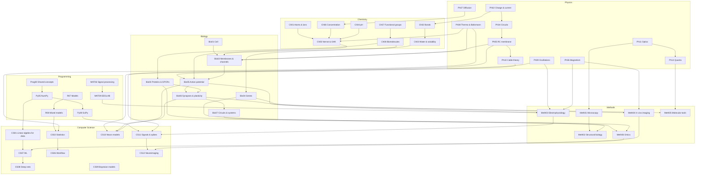

# 🧠 Neuroscience Foundations – Physics, Chemistry, Biology, Methods, Computer Science, Programming

> Companion to the math vault: [[00 Roadmap]] · Fields: [[MOC-physics]] · [[MOC-chemistry]] · [[MOC-biology]] · [[MOC-methods]] · [[MOC-computer-science]] · [[MOC-programming]]

This part of the vault reviews the physical, chemical and biological basics you need to understand neuroscience, an overview of the main methods, the computer science concepts (data, statistics, machine learning, models) used to analyse neural data, and the practical programming skills (Python, R, MATLAB, Markdown/HTML/LaTeX) to apply them. Each topic has a **theory note** (concepts with examples, a `#neuro` section, a `#math-link` section), a **worksheet** (recall → understanding → calculation → neuro transfer) and a **solution sheet**. Each field has a **mistake log** for misconceptions.

## The six fields
| Field | Map of Content | Mistake log | Core question |
|---|---|---|---|
| 0 · Physics | [[MOC-physics]] | [[Mistakes - Physics]] | Which physical laws (energy, charge, circuits, diffusion, heat, waves, light) govern neurons and methods? |
| 1 · Chemistry | [[MOC-chemistry]] | [[Mistakes - Chemistry]] | What is the brain made of, and where does electrical energy come from? |
| 2 · Biology | [[MOC-biology]] | [[Mistakes - Biology]] | How do cells, neurons, synapses and circuits work? |
| 3 · Methods | [[MOC-methods]] | [[Mistakes - Methods]] | How do we know? What does each method really measure? |
| 4 · Computer Science | [[MOC-computer-science]] | [[Mistakes - Computer Science]] | How do we represent, analyse and model neural data, and how does the brain itself compute? |
| 5 · Programming | [[MOC-programming]] | [[Mistakes - Programming Basics]] · [[Mistakes - Python]] · [[Mistakes - R]] · [[Mistakes - MATLAB]] · [[Mistakes - Markdown HTML LaTeX]] | How do I actually do it – in Python, R and MATLAB – and how do I write it up? |

## Learning path
The order follows dependencies. Physics comes **early**, interleaved with chemistry, so that every equation you meet later already has its physical meaning. ⭐ marks the key notes.

| Stage | Notes | Why here |
|---|---|---|
| 1 · Physics basics (school) | [[Ph01 Mechanics and Energy]] → [[Ph02 Electricity and Charge]] | energy, charge, current vs. voltage: the vocabulary for everything else |
| 2 · Matter & charge | [[Ch01 Atomic Structure]] → [[Ch02 Chemical Bonds]] → [[Ch03 Intermolecular Forces and Solubility]] | ions, bonds and water; Coulomb's law applied |
| 3 · Electricity of the membrane | [[Ph03 Electric Fields and Potential]] → ⭐ [[Ph04 Circuits and Resistance]] → ⭐ [[Ph05 Capacitance and RC Circuits]] | potential, Ohm, Kirchhoff, τ = RC: the neuron as a circuit |
| 4 · Molecular physics | [[Ph07 Diffusion and Transport]] → ⭐ [[Ph08 Thermodynamics and Statistics]] | Fick, Nernst–Planck, kT, Boltzmann, ΔG |
| 5 · Quantities & gradients | [[Ch06 Solutions and Concentration]] → [[Ch04 Acids Bases and pH]] → ⭐ [[Ch05 Redox and Electrochemistry]] | concentrations → pH → **Nernst/GHK**; needs [[A3 Logarithms]] |
| 6 · Molecules of life | [[Ch07 Organic Chemistry Essentials]] → [[Ch08 Biomolecules]] | functional groups, chirality, the four classes of biomolecules |
| 7 · The cell | [[Bio01 Cell Biology]] → [[Bio02 Membranes and Transport]] | organelles, transport, channels and pumps |
| 8 · Molecules at work | [[Bio03 Proteins and Enzymes]] → [[Bio04 Nucleic Acids and Gene Expression]] | structure, enzymes, GPCRs, genes, splicing |
| 9 · Neural signalling | [[Ph10 Signal Propagation and Cable Theory]] → ⭐ [[Bio05 Neurons and Action Potentials]] → ⭐ [[Bio06 Synapses and Neurotransmitters]] | cable theory, AP, synapses, plasticity; needs [[B2 Exponential Functions]] |
| 10 · Systems | [[Bio07 Neural Circuits and Systems]] | anatomy, development, glia |
| 11 · Physics for methods | [[Ph09 Waves and Oscillations]] → [[Ph06 Magnetism and Induction]] → [[Ph11 Optics and Fluorescence]] → [[Ph12 Quantum Basics for Biophysics]] | Fourier and filters, TMS and MEG, optics and photons |
| 12 · Recording activity | [[Meth03 Electrophysiology]] → [[Meth04 In Vivo Imaging]] | measuring what you learned in stage 9 |
| 13 · Seeing structure | [[Meth01 Microscopy]] → [[Meth02 Structural Biology]] | from tissue to atoms |
| 14 · Molecular manipulation & big data | [[Meth05 Molecular Biology Tools]] → [[Meth06 Omics and Sequencing]] | CRISPR, optogenetics, AAV; RNA-seq, connectomics |
| 15 · CS: mathematical toolkit | [[CS01 Mathematical Foundations]] → ⭐ [[CS02 Probability and Statistics]] → [[CS03 Information Theory]] → [[CS04 Optimization]] | SVD/PCA, Bayes, entropy, gradient descent; needs math stages 7–12 |
| 16 · CS: data handling | [[CS05 Data Formats and Representation]] → ⭐ [[CS06 Data Science Workflow]] | formats, metadata, CV, leakage, power |
| 17 · CS: learning machines | [[CS07 Machine Learning Fundamentals]] → [[CS08 Deep Neural Networks]] → [[CS09 Probabilistic and Bayesian Models]] | regression to transformers; GLMs, HMMs, Kalman |
| 18 · CS: brain models & analysis | [[CS10 Dynamical and Computational Neuro Models]] → [[CS11 Time Series and Signal Processing]] → [[CS12 Neuroimaging Data Analysis]] | LIF/HH, attractors, TD learning; spikes, spectra; fMRI GLM, MVPA, RSA |
| 19 · CS: infrastructure | [[CS13 Reproducibility and Research Software]] → [[CS14 Hardware Essentials]] | git, containers, FAIR, GDPR; GPUs, storage |

*Stages 15–16 can also run in parallel with stages 9–14; [[CS13 Reproducibility and Research Software]] is worth reading before your first own data project.*

**Programming track (in parallel, starting early)** – details in [[MOC-programming]]:
| Track stage | Notes | Run it alongside |
|---|---|---|
| P1–P2 · shared concepts, Python basics → NumPy | [[Prog00 Shared Programming Concepts]] → [[Py01 Python Basics and Syntax]] … ⭐ [[Py05 NumPy and Arrays]] | stages 1–5 (check calculations, plot functions) |
| P3 · Markdown, HTML, LaTeX | [[Doc01 Markdown Syntax]] → [[Doc02 Math in Markdown]] → [[Doc03 HTML Basics]] → [[Doc05 LaTeX Basics]] → [[Doc06 LaTeX Math]] | from the start (you write in this vault) |
| P4–P5 · R basics & tidyverse, MATLAB basics | [[R01 R Basics and Syntax]] … [[R06 ggplot2 Visualization]] · [[MAT01 MATLAB Basics and Syntax]] … [[MAT03 MATLAB Control Flow and Functions]] | stages 6–10 |
| P6 · applications | ⭐ [[Py08 SciPy Scientific Computing]], [[Py10 Python Neuroscience Packages]], ⭐ [[R07 R Statistical Modelling]], ⭐ [[R08 R Mixed-Effects Models]], [[MAT06 MATLAB Signal Processing Toolbox]], [[MAT09 EEGLAB]] | stages 11–18 |
| P7 · experiment control | [[Py11 PsychoPy Experiment Control]], [[MAT08 Psychtoolbox]] | stage 12 (recording activity) |
| P8 · reproducible projects | [[Py13 Python Reproducible Projects and Testing]], [[R11 R Reproducible Projects]], [[MAT12 MATLAB Reproducible Projects]] | stage 19 |

**Combining with math:** a good rhythm is to finish the math stage a note needs first.
- Math stages 1–3 (exponents, logs, exponentials) → before stages 3–5 here
- Math stage 7 (derivatives) and [[B10 Differential Equations]] (math stage 13) → before stage 9 (cable equation, Hodgkin–Huxley)
- [[B11 Multivariable Calculus]] → before stages 15–17 (gradients, backprop)
- Math stage 4 (trigonometry), E2 (complex numbers) and [[B12 Fourier Analysis]] → before stage 11 (oscillations, Fourier)
- Math stages 10–12 (vectors, matrices, eigenvalues) → before methods stages 12 and 14

## How the fields connect

## Key cross-cutting threads
| Thread | Path through the vault |
|---|---|
| **From ion to action potential** | [[Ph02 Electricity and Charge]] → [[Ch01 Atomic Structure]] → [[Ph03 Electric Fields and Potential]] → [[Ch05 Redox and Electrochemistry]] → [[Ph04 Circuits and Resistance]] → [[Ph05 Capacitance and RC Circuits]] → [[Bio02 Membranes and Transport]] → [[Ph10 Signal Propagation and Cable Theory]] → [[Bio05 Neurons and Action Potentials]] → [[Meth03 Electrophysiology]] |
| **From photon to signal** | [[Ph12 Quantum Basics for Biophysics]] → [[Ph11 Optics and Fluorescence]] → [[Meth01 Microscopy]] → [[Meth04 In Vivo Imaging]] (GCaMP) → [[Meth05 Molecular Biology Tools]] (optogenetics) |
| **From rhythm to spectrum** | [[Ph09 Waves and Oscillations]] → [[E2 Complex Numbers]] → [[Meth03 Electrophysiology]] (EEG/MEG) → [[Ph06 Magnetism and Induction]] (MEG, TMS) |
| **From spikes to models** | [[Meth03 Electrophysiology]] → [[CS05 Data Formats and Representation]] (NWB) → [[CS11 Time Series and Signal Processing]] (spike sorting) → [[CS02 Probability and Statistics]] (Poisson) → [[CS09 Probabilistic and Bayesian Models]] (GLM) → [[CS10 Dynamical and Computational Neuro Models]] |
| **From scanner to brain map** | [[Meth04 In Vivo Imaging]] → [[CS05 Data Formats and Representation]] (BIDS) → [[CS12 Neuroimaging Data Analysis]] (preprocessing, GLM, MVPA, RSA) → [[CS06 Data Science Workflow]] (leakage, power) → [[CS13 Reproducibility and Research Software]] |
| **Learning in brains and machines** | [[Bio06 Synapses and Neurotransmitters]] (LTP) → [[CS04 Optimization]] (gradient descent) → [[CS08 Deep Neural Networks]] (backprop) → [[CS10 Dynamical and Computational Neuro Models]] (TD learning, dopamine) → [[Bio07 Neural Circuits and Systems]] (basal ganglia) |
| **Thermodynamics of signalling** | [[Ph08 Thermodynamics and Statistics]] (Boltzmann, ΔG) → [[Ph07 Diffusion and Transport]] (Nernst–Planck) → [[Bio02 Membranes and Transport]] (gating, pumps) → [[Bio06 Synapses and Neurotransmitters]] (release probability) |
| **From transmitter molecule to drug** | [[Ch07 Organic Chemistry Essentials]] → [[Ch08 Biomolecules]] → [[Bio03 Proteins and Enzymes]] → [[Bio06 Synapses and Neurotransmitters]] → [[Meth04 In Vivo Imaging]] (PET) |
| **From gene to cell type** | [[Ch08 Biomolecules]] → [[Bio04 Nucleic Acids and Gene Expression]] → [[Meth05 Molecular Biology Tools]] → [[Meth06 Omics and Sequencing]] |
| **Protein misfolding and neurodegeneration** | [[Ch02 Chemical Bonds]] → [[Bio03 Proteins and Enzymes]] → [[Bio01 Cell Biology]] → [[Meth02 Structural Biology]] → [[Meth04 In Vivo Imaging]] (amyloid/tau PET) |
| **Learning and memory** | [[Bio06 Synapses and Neurotransmitters]] (LTP) → [[Bio04 Nucleic Acids and Gene Expression]] (CREB) → [[Bio07 Neural Circuits and Systems]] (hippocampus) → [[Meth05 Molecular Biology Tools]] (optogenetics) |
| **From equation to simulation** | [[B10 Differential Equations]] → [[Ph05 Capacitance and RC Circuits]] → [[Py03 Python Control Flow and Functions]] (Euler loop) → [[Py08 SciPy Scientific Computing]] (`solve_ivp`) → [[Py10 Python Neuroscience Packages]] (Brian2) → [[CS10 Dynamical and Computational Neuro Models]] |
| **From trigger to ERP to statistics** | [[Py11 PsychoPy Experiment Control]] / [[MAT08 Psychtoolbox]] → [[Meth03 Electrophysiology]] → [[MAT09 EEGLAB]] / [[Py10 Python Neuroscience Packages]] (MNE) → [[R05 dplyr and tidyr]] → [[R08 R Mixed-Effects Models]] → [[R10 R Markdown and Quarto]] |
| **Energy** | [[Ch05 Redox and Electrochemistry]] (ATP, mitochondria) → [[Bio02 Membranes and Transport]] (Na⁺/K⁺-ATPase) → [[Meth04 In Vivo Imaging]] (BOLD, FDG-PET) |

## Math ↔ neuroscience: where the math is used
| Math note | Used in |
|---|---|
| [[A1 Exponent Rules]] | units and orders of magnitude everywhere; [[Ch01 Atomic Structure]], [[Ch06 Solutions and Concentration]] |
| [[A2 Root Rules]] | diffusion $\sqrt{2Dt}$, length constant, $\sqrt N$ averaging; [[Ch06 Solutions and Concentration]], [[Bio05 Neurons and Action Potentials]], [[Meth03 Electrophysiology]] |
| [[A3 Logarithms]] | pH, Henderson–Hasselbalch, **Nernst/GHK**, log P, qPCR Ct, log₂FC; [[Ch04 Acids Bases and pH]], [[Ch05 Redox and Electrochemistry]], [[Meth05 Molecular Biology Tools]], [[Meth06 Omics and Sequencing]] |
| [[A5 Fractions]] | Michaelis–Menten, occupancy, Hill, ΔF/F; [[Bio03 Proteins and Enzymes]], [[Meth04 In Vivo Imaging]] |
| [[A6 Binomial Formulas and Theorem]] | quantal release; [[Bio06 Synapses and Neurotransmitters]] |
| [[B2 Exponential Functions]] | membrane charging, decay, PCR, radioactive decay; [[Bio05 Neurons and Action Potentials]], [[Meth04 In Vivo Imaging]], [[Meth05 Molecular Biology Tools]] |
| [[B6 Differentiation Rules]] | Hodgkin–Huxley, Fick's law; [[Bio05 Neurons and Action Potentials]], [[Ch06 Solutions and Concentration]] |
| [[B7 Antiderivatives and Integration]] | convolution (HRF, PSF); [[Meth04 In Vivo Imaging]], [[Meth01 Microscopy]] |
| [[B10 Differential Equations]] | membrane equation, LIF, Hodgkin–Huxley gating, diffusion and cable PDEs, rate networks; [[Ph05 Capacitance and RC Circuits]], [[Bio05 Neurons and Action Potentials]], [[Ph10 Signal Propagation and Cable Theory]], [[CS10 Dynamical and Computational Neuro Models]] |
| [[B11 Multivariable Calculus]] | gradients and loss landscapes, Jacobians, $\mathbf E = -\nabla V$, joint densities; [[CS04 Optimization]], [[CS08 Deep Neural Networks]], [[Ph03 Electric Fields and Potential]], [[CS02 Probability and Statistics]] |
| [[B12 Fourier Analysis]] | EEG/MEG spectra, filters, MRI k-space, diffraction; [[Ph09 Waves and Oscillations]], [[CS11 Time Series and Signal Processing]], [[Meth04 In Vivo Imaging]], [[Meth02 Structural Biology]] |
| [[C1 Matrices]], [[C3 Linear Systems and Gaussian Elimination]] | GLM, connectomes, source localisation; [[Meth04 In Vivo Imaging]], [[Meth06 Omics and Sequencing]], [[Meth03 Electrophysiology]] |
| [[C4 Eigenvalues and Eigenvectors]] | PCA (spike sorting, scRNA-seq), DTI, network stability; [[Meth06 Omics and Sequencing]], [[Bio07 Neural Circuits and Systems]] |
| [[D2 Dot and Cross Product]] | MEG and radial dipoles, cosine similarity; [[Meth03 Electrophysiology]], [[Meth06 Omics and Sequencing]] |
| [[D4 Unit Circle Trigonometry]] | NA = n sin θ, Bragg's law; [[Meth01 Microscopy]], [[Meth02 Structural Biology]] |
| [[E1 Sets Logic and Quantifiers]] | necessity vs. sufficiency, multiple testing; [[Meth05 Molecular Biology Tools]], [[Bio07 Neural Circuits and Systems]] |
| [[E2 Complex Numbers]] | Fourier transforms in EEG, microscopy, crystallography |

## How to work with these notes
1. **Read** the theory note and try to explain each table row aloud in your own words.
2. **Do the worksheet**: Level 1–2 for facts and concepts, Level 3 for calculations (no calculator except 🧮), Level 4 for transfer to neuroscience.
3. **Check** with the solutions, comparing your reasoning, not just keywords.
4. **Log misconceptions** in the field's mistake log ([[Mistake Entry Template]]).
5. Link your **lecture notes** ([[Lecture Note Template]], `#lecture`) to the topic notes. They then appear in the backlinks.

## Tags
| Tag | Meaning |
|---|---|
| `#physics`, `#chemistry`, `#biology`, `#methods`, `#computer-science` | field |
| `#linear-algebra` `#svd` `#pca` `#gradient` `#probability` `#statistics` `#bayes` `#information-theory` `#entropy` `#neural-coding` `#optimization` `#gradient-descent` `#regularization` `#data-format` `#metadata` `#nwb` `#bids` `#data-science` `#cross-validation` `#power` `#machine-learning` `#classification` `#clustering` `#deep-learning` `#backpropagation` `#cnn` `#transformer` `#hmm` `#kalman` `#glm` `#computational-neuroscience` `#dynamical-systems` `#reinforcement-learning` `#signal-processing` `#convolution` `#spike-sorting` `#neuroimaging` `#mvpa` `#rsa` `#reproducibility` `#open-science` `#version-control` `#ethics` `#hardware` `#gpu` `#storage` | computer science topics |
| `#mechanics` `#energy` `#charge` `#current` `#voltage` `#coulomb` `#electric-field` `#potential` `#membrane-potential` `#circuit` `#resistance` `#conductance` `#kirchhoff` `#capacitance` `#rc-circuit` `#time-constant` `#magnetism` `#induction` `#tms` `#meg` `#electrodiffusion` `#thermodynamics` `#boltzmann` `#free-energy` `#entropy` `#oscillation` `#fourier` `#filter` `#cable-theory` `#conduction` `#hodgkin-huxley` `#optics` `#fluorescence` `#diffraction` `#quantum` `#photon` `#spectroscopy` | physics topics |
| `#programming` `#python` `#r` `#matlab` `#markdown` `#html` `#latex` `#numpy` `#pandas` `#scipy` `#tidyverse` `#ggplot2` `#mixed-models` `#psychopy` `#psychtoolbox` `#eeglab` `#quarto` `#testing` | programming (full list in [[MOC-programming]]) |
| `#type/overview`, `#type/worksheet`, `#type/solution`, `#type/mistakes`, `#type/moc` | kind of note (same as in the math vault) |
| `#neuro` | neuroscience application sections |
| `#math-link` | sections linking to the math notes |
| `#atom` `#ion` `#bond` `#water` `#solubility` `#ph` `#buffer` `#electrochemistry` `#nernst` `#redox` `#concentration` `#osmosis` `#diffusion` `#organic` `#functional-group` `#chirality` `#biomolecule` `#amino-acid` `#lipid` `#carbohydrate` `#nucleotide` | chemistry topics |
| `#cell` `#organelle` `#cytoskeleton` `#vesicle` `#membrane` `#transport` `#ion-channel` `#protein` `#enzyme` `#gpcr` `#misfolding` `#gene-expression` `#epigenetics` `#splicing` `#neuron` `#action-potential` `#myelin` `#synapse` `#neurotransmitter` `#receptor` `#plasticity` `#anatomy` `#development` `#glia` `#circuit` | biology topics |
| `#microscopy` `#super-resolution` `#electron-microscopy` `#cryo-em` `#structural-biology` `#mass-spec` `#electrophysiology` `#patch-clamp` `#eeg` `#fmri` `#pet` `#calcium-imaging` `#imaging` `#pcr` `#antibody` `#crispr` `#optogenetics` `#aav` `#sequencing` `#proteomics` `#connectomics` | methods |

## Progress
- [ ] Stage 1 – Physics basics
- [ ] Stage 2 – Matter & charge
- [ ] Stage 3 – Electricity of the membrane
- [ ] Stage 4 – Molecular physics
- [ ] Stage 5 – Quantities & gradients
- [ ] Stage 6 – Molecules of life
- [ ] Stage 7 – The cell
- [ ] Stage 8 – Molecules at work
- [ ] Stage 9 – Neural signalling
- [ ] Stage 10 – Systems
- [ ] Stage 11 – Physics for methods
- [ ] Stage 12 – Recording activity
- [ ] Stage 13 – Seeing structure
- [ ] Stage 14 – Molecular manipulation & big data
- [ ] Stage 15 – CS: mathematical toolkit
- [ ] Stage 16 – CS: data handling
- [ ] Stage 17 – CS: learning machines
- [ ] Stage 18 – CS: brain models & analysis
- [ ] Stage 19 – CS: infrastructure
- [ ] Programming track P1–P8 (see [[MOC-programming]])
